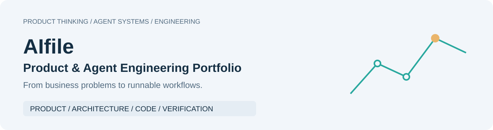
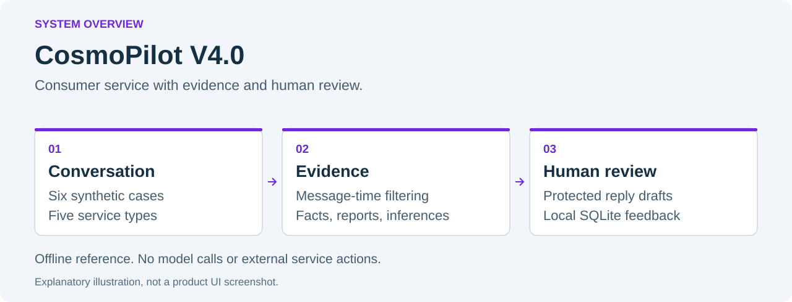
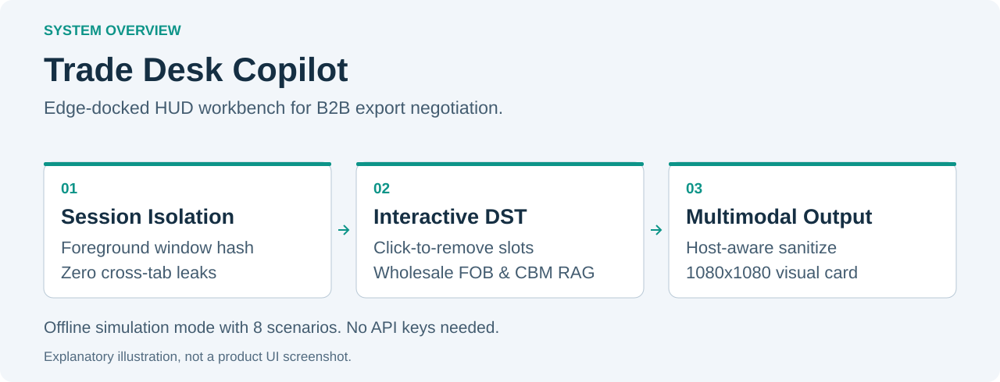
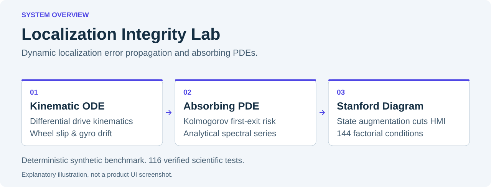
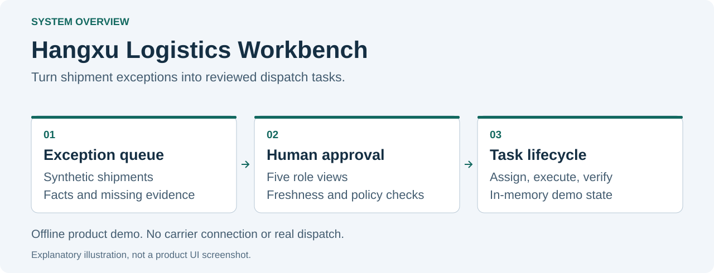
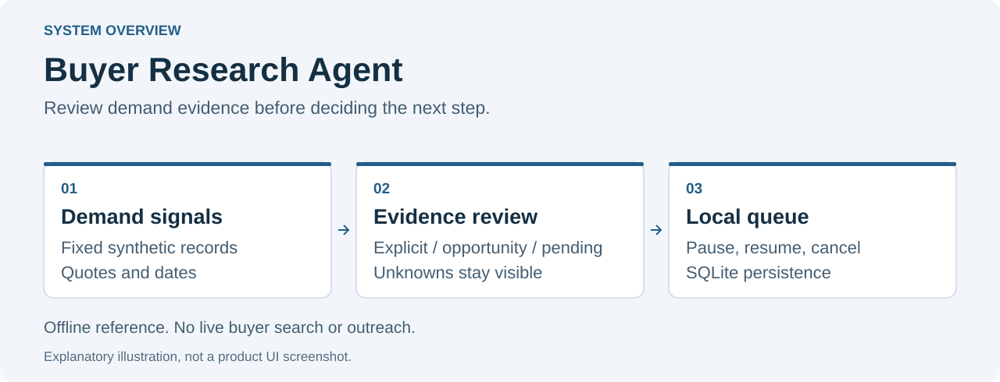
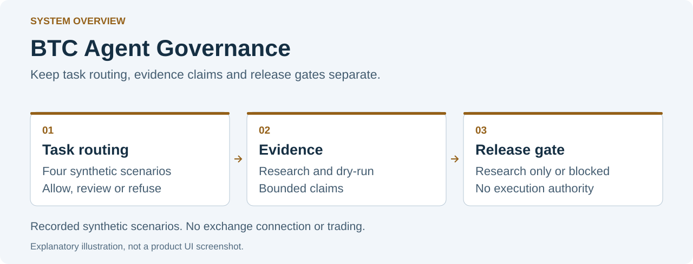

<p align="right"><strong>Language / 语言:</strong> <a href="README.md">中文</a> · <strong>English</strong></p>

<picture>
  <source media="(prefers-color-scheme: dark)" srcset="assets/cover-en-dark.svg" />
  
</picture>

# AIfile · Product and Agent Engineering Portfolio

[English profile](https://github.com/Daniel-24-life/Daniel-24-life/blob/main/README.en.md) · [Add a project (Chinese)](docs/ADD_PROJECT.md)

Public product reconstructions, bounded agents, research workflows and reusable
methods. Each entry separates implemented behavior, synthetic examples and
verification limits. Directory release: [v3.2](CHANGELOG.md).

Featured projects have independent repositories and English overviews. The
English illustrations explain system structure, not translated product UIs.
Deep documents marked “Chinese”, and some directory entries, retain their original language.

<!-- portfolio:start -->

## Selected work

<table>
<tbody>
<tr>
<td width="50%" valign="top">
<h3><a href="https://github.com/Daniel-24-life/cosmopilot-v4/blob/main/README.en.md">CosmoPilot V4.0</a></h3>
<a href="https://github.com/Daniel-24-life/cosmopilot-v4/blob/main/README.en.md"></a>
<p>Consumer-service evidence, protected drafts and local feedback in one workspace.</p>
<p><strong>Offline public reference of V4.0 mechanisms</strong></p>
<p><a href="https://github.com/Daniel-24-life/cosmopilot-v4/blob/main/README.en.md">Run / overview</a> · <a href="https://github.com/Daniel-24-life/cosmopilot-v4/blob/main/docs/architecture.md">Architecture (Chinese)</a> · <a href="https://github.com/Daniel-24-life/cosmopilot-v4/blob/main/docs/source-reading.md">Source guide (Chinese)</a> · <a href="https://github.com/Daniel-24-life/cosmopilot-v4/blob/main/docs/VERIFICATION.md">Verification (Chinese)</a></p>
</td>
<td width="50%" valign="top">
<h3><a href="https://github.com/Daniel-24-life/trade-desk-copilot/blob/main/README.en.md">Trade Desk Copilot</a></h3>
<a href="https://github.com/Daniel-24-life/trade-desk-copilot/blob/main/README.en.md"></a>
<p>Edge-docked HUD workbench: session isolation, interactive DST slot tracking, RAG catalog grounding, and 1080x1080 quotation cards.</p>
<p><strong>Offline product demo</strong></p>
<p><a href="https://github.com/Daniel-24-life/trade-desk-copilot/blob/main/README.en.md">Run / overview</a> · <a href="https://github.com/Daniel-24-life/trade-desk-copilot/blob/main/assets/screenshots/architecture_overview.svg">Architecture (Chinese)</a> · <a href="https://github.com/Daniel-24-life/trade-desk-copilot/blob/main/core/agent.py">Source</a> · <a href="https://github.com/Daniel-24-life/trade-desk-copilot/blob/main/README.md">Verification (Chinese)</a></p>
</td>
</tr>
<tr>
<td width="50%" valign="top">
<h3><a href="https://github.com/Daniel-24-life/localization-integrity-lab/blob/main/README.en.md">Localization Integrity Lab</a></h3>
<a href="https://github.com/Daniel-24-life/localization-integrity-lab/blob/main/README.en.md"></a>
<p>Kinematic ODEs, Gramian observability, absorbing boundary PDEs, and colored-noise filtering.</p>
<p><strong>Reproducible research benchmark</strong></p>
<p><a href="https://github.com/Daniel-24-life/localization-integrity-lab/blob/main/README.en.md">Run / overview</a> · <a href="https://github.com/Daniel-24-life/localization-integrity-lab/blob/main/assets/screenshots/research_overview.svg">Architecture (Chinese)</a> · <a href="https://github.com/Daniel-24-life/localization-integrity-lab/blob/main/scripts/run_synthetic_study.py">Source</a> · <a href="https://github.com/Daniel-24-life/localization-integrity-lab/blob/main/docs/mathematical_formulation.md">Verification (Chinese)</a></p>
</td>
<td width="50%" valign="top">
<h3><a href="https://github.com/Daniel-24-life/logistics-workbench/blob/main/README.en.md">Hangxu Logistics Workbench</a></h3>
<a href="https://github.com/Daniel-24-life/logistics-workbench/blob/main/README.en.md"></a>
<p>A synthetic exception-to-task workflow with role views.</p>
<p><strong>Offline product demo</strong></p>
<p><a href="https://github.com/Daniel-24-life/logistics-workbench/blob/main/README.en.md">Run / overview</a> · <a href="https://github.com/Daniel-24-life/logistics-workbench/blob/main/docs/architecture.md">Architecture (Chinese)</a> · <a href="https://github.com/Daniel-24-life/logistics-workbench/tree/main/dist">Source</a> · <a href="https://github.com/Daniel-24-life/logistics-workbench/blob/main/docs/VERIFICATION.md">Verification (Chinese)</a></p>
</td>
</tr>
<tr>
<td width="50%" valign="top">
<h3><a href="https://github.com/Daniel-24-life/buyer-research-agent/blob/main/README.en.md">Buyer Research Agent</a></h3>
<a href="https://github.com/Daniel-24-life/buyer-research-agent/blob/main/README.en.md"></a>
<p>Demand evidence, unknowns and a durable local queue.</p>
<p><strong>Offline reference</strong></p>
<p><a href="https://github.com/Daniel-24-life/buyer-research-agent/blob/main/README.en.md">Run / overview</a> · <a href="https://github.com/Daniel-24-life/buyer-research-agent/blob/main/docs/architecture.md">Architecture (Chinese)</a> · <a href="https://github.com/Daniel-24-life/buyer-research-agent/blob/main/core.py">Source</a> · <a href="https://github.com/Daniel-24-life/buyer-research-agent/blob/main/docs/VERIFICATION.md">Verification (Chinese)</a></p>
</td>
<td width="50%" valign="top">
<h3><a href="https://github.com/Daniel-24-life/btc-agent-governance/blob/main/README.en.md">BTC Agent Governance</a></h3>
<a href="https://github.com/Daniel-24-life/btc-agent-governance/blob/main/README.en.md"></a>
<p>Four synthetic scenarios with bounded evidence and no trading authority.</p>
<p><strong>Research governance skeleton</strong></p>
<p><a href="https://github.com/Daniel-24-life/btc-agent-governance/blob/main/README.en.md">Run / overview</a> · <a href="https://github.com/Daniel-24-life/btc-agent-governance/blob/main/docs/architecture.md">Architecture (Chinese)</a> · <a href="https://github.com/Daniel-24-life/btc-agent-governance/blob/main/public_demo.py">Source</a> · <a href="https://github.com/Daniel-24-life/btc-agent-governance/blob/main/docs/VERIFICATION.md">Verification (Chinese)</a></p>
</td>
</tr>
</tbody>
</table>

## Project directory

### Business products

| Project | Focus | State |
| --- | --- | --- |
| [CosmoPilot V4.0](https://github.com/Daniel-24-life/cosmopilot-v4/blob/main/README.en.md) | Consumer-service evidence, protected drafts and local feedback in one workspace. | Offline public reference of V4.0 mechanisms |
| [Hangxu Logistics Workbench](https://github.com/Daniel-24-life/logistics-workbench/blob/main/README.en.md) | A synthetic exception-to-task workflow with role views. | Offline product demo |
| [Buyer Research Agent](https://github.com/Daniel-24-life/buyer-research-agent/blob/main/README.en.md) | Demand evidence, unknowns and a durable local queue. | Offline reference |
| [Trade Desk Copilot](https://github.com/Daniel-24-life/trade-desk-copilot/blob/main/README.en.md) | Edge-docked HUD workbench: session isolation, interactive DST slot tracking, RAG catalog grounding, and 1080x1080 quotation cards. | Offline product demo |
| [Creator Discovery Pipeline](showcases/creator-discovery-pipeline/) | Normalize public signals into a reviewed handoff table. | Synthetic case and skeleton |

### Agent engineering

| Project | Focus | State |
| --- | --- | --- |
| [BTC Agent Governance](https://github.com/Daniel-24-life/btc-agent-governance/blob/main/README.en.md) | Four synthetic scenarios with bounded evidence and no trading authority. | Research governance skeleton |
| [Mailbox Governance Agent](showcases/mailbox-agent-system/) | Synthetic action review without mailbox connectivity or delivery. | Local policy demo |
| [Daily Brief Agent](showcases/daily-brief-agent/) | Source classes, citation checks and uncertain-claim review. | Synthetic case and skeleton |

### Research and content

| Project | Focus | State |
| --- | --- | --- |
| [Localization Integrity Lab](https://github.com/Daniel-24-life/localization-integrity-lab/blob/main/README.en.md) | Kinematic ODEs, Gramian observability, absorbing boundary PDEs, and colored-noise filtering. | Reproducible research benchmark |
| [WTI Market Research Case](showcases/wti-market-research/) | Timing-aware public-series research and frozen-test audits. | Sanitized research case |
| [AIGC Video Production Pipeline](showcases/aigc-video-production-pipeline/) | Shot planning, asset review and delivery checks. | Public workflow and reconstructed sample |

### Methods and learning

| Project | Focus | State |
| --- | --- | --- |
| [AI Skill Routing Playbook](shelves/skills/ai-skill-routing-playbook/) | Task-first selection with explicit workflow boundaries. | Public playbook |
| [AI Workflow Learning System](shelves/understanding/ai-workflow-learning-system/) | Turn reading and checked practice into reusable working rules. | Methods and handbook |

### Engineering retrospectives

| Project | Focus | State |
| --- | --- | --- |
| [AgentPlatform Case Study](https://github.com/Daniel-24-life/agentplatform-case-study/blob/main/README.en.md) | Controlled single-task execution and lessons from a discontinued product. | Discontinued |

## Recent releases

- 2026-11-04 · [Trade Desk Copilot](https://github.com/Daniel-24-life/trade-desk-copilot/blob/main/README.en.md) · v1.0 — Initial open-source release: dual-mode offline simulation, interactive DST state machine, and host-aware formatting.
- 2026-11-04 · [Localization Integrity Lab](https://github.com/Daniel-24-life/localization-integrity-lab/blob/main/README.en.md) · v1.0 — Initial research release: 144-condition benchmark, absorbing boundary PDE solvers, and 116 tests.
- 2026-10-25 · [CosmoPilot V4.0](https://github.com/Daniel-24-life/cosmopilot-v4/blob/main/README.en.md) · V4.0 public reference — Consumer-service workspace, AI Coding notes and synthetic reference demo.

## Add the next project

[Publishing guide and templates (Chinese)](docs/ADD_PROJECT.md)

<!-- portfolio:end -->

## Verification and boundaries

Python 3.11+:

```sh
python -m pip install -r requirements-dev.txt
python scripts/verify_public_packages.py
```

This repository verifies its registry, generated content, relative links,
public text and four retained code packages. Independent projects run their own
behavior tests and CI. Deep documentation retains its original language.

See the [registry](catalog/projects.json), [code shelf](shelves/code/),
[design notes](docs/DESIGN_NOTES.md) and [publication guide](docs/ADD_PROJECT.md).
Credentials, real contacts, transactions, private materials and production
execution chains are excluded. AgentPlatform remains a discontinued case study.
