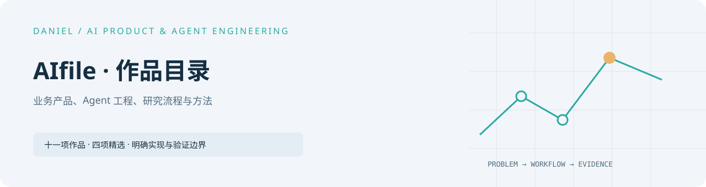
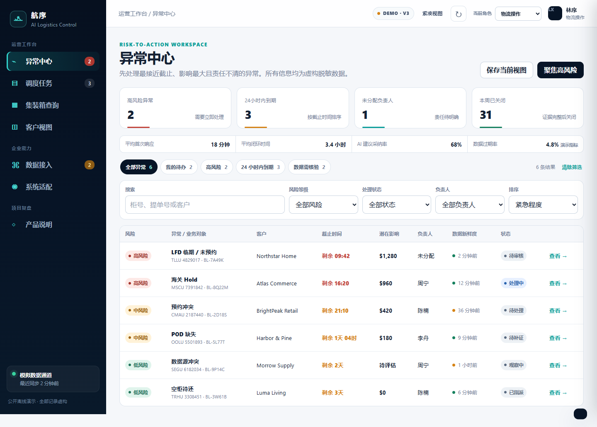
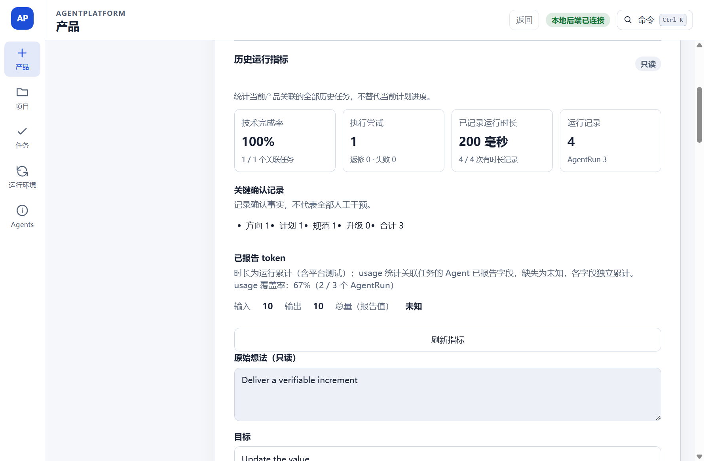

<picture>
  <source media="(prefers-color-scheme: dark)" srcset="assets/cover-dark.svg" />
  
</picture>

# AIfile · Product and Agent Engineering Portfolio

[中文](README.md) · [Profile](https://github.com/Daniel-24-life) · [Add a project](docs/ADD_PROJECT.md)

Public product reconstructions, bounded agents, research workflows and reusable
methods. Each entry separates implemented behavior, synthetic examples and
verification limits. Directory release: [v3.0](CHANGELOG.md).

The logistics, buyer research and BTC governance projects maintain their code in
independent repositories. Four other code references remain here.

<!-- portfolio:start -->

## Selected work

<table>
<tbody>
<tr>
<td width="50%" valign="top">
<h3><a href="https://github.com/Daniel-24-life/logistics-workbench">Hangxu Logistics Workbench</a></h3>
<a href="https://github.com/Daniel-24-life/logistics-workbench"></a>
<p>A synthetic exception-to-task workflow with role views.</p>
<p><strong>Offline product demo</strong></p>
<p><a href="https://github.com/Daniel-24-life/logistics-workbench">Run / overview</a> · <a href="https://github.com/Daniel-24-life/logistics-workbench/blob/main/docs/architecture.md">Architecture</a> · <a href="https://github.com/Daniel-24-life/logistics-workbench/tree/main/dist">Source</a> · <a href="https://github.com/Daniel-24-life/logistics-workbench/blob/main/docs/VERIFICATION.md">Verification</a></p>
</td>
<td width="50%" valign="top">
<h3><a href="https://github.com/Daniel-24-life/buyer-research-agent">Buyer Research Agent</a></h3>
<a href="https://github.com/Daniel-24-life/buyer-research-agent"></a>
<p>Demand evidence, unknowns and a durable local queue.</p>
<p><strong>Offline reference</strong></p>
<p><a href="https://github.com/Daniel-24-life/buyer-research-agent">Run / overview</a> · <a href="https://github.com/Daniel-24-life/buyer-research-agent/blob/main/docs/architecture.md">Architecture</a> · <a href="https://github.com/Daniel-24-life/buyer-research-agent/blob/main/core.py">Source</a> · <a href="https://github.com/Daniel-24-life/buyer-research-agent/blob/main/docs/VERIFICATION.md">Verification</a></p>
</td>
</tr>
<tr>
<td width="50%" valign="top">
<h3><a href="https://github.com/Daniel-24-life/btc-agent-governance">BTC Agent Governance</a></h3>
<a href="https://github.com/Daniel-24-life/btc-agent-governance"></a>
<p>Four synthetic scenarios with bounded evidence and no trading authority.</p>
<p><strong>Research governance skeleton</strong></p>
<p><a href="https://github.com/Daniel-24-life/btc-agent-governance">Run / overview</a> · <a href="https://github.com/Daniel-24-life/btc-agent-governance/blob/main/docs/architecture.md">Architecture</a> · <a href="https://github.com/Daniel-24-life/btc-agent-governance/blob/main/public_demo.py">Source</a> · <a href="https://github.com/Daniel-24-life/btc-agent-governance/blob/main/docs/VERIFICATION.md">Verification</a></p>
</td>
<td width="50%" valign="top">
<h3><a href="https://github.com/Daniel-24-life/agentplatform-case-study">AgentPlatform Case Study</a></h3>
<a href="https://github.com/Daniel-24-life/agentplatform-case-study"></a>
<p>Trusted single-task execution and an unfulfilled product experience.</p>
<p><strong>Discontinued</strong></p>
<p><a href="https://github.com/Daniel-24-life/agentplatform-case-study">Run / overview</a> · <a href="https://github.com/Daniel-24-life/agentplatform-case-study/blob/main/docs/ARCHIVE_ARCHITECTURE.md">Architecture</a> · <a href="https://github.com/Daniel-24-life/agentplatform-case-study/blob/main/docs/SOURCE_READING_GUIDE.md">Source</a> · <a href="https://github.com/Daniel-24-life/agentplatform-case-study/blob/main/docs/VERIFICATION_RECORD.md">Verification</a></p>
</td>
</tr>
</tbody>
</table>

## Project directory

### Business products

| Project | Focus | State |
| --- | --- | --- |
| [Hangxu Logistics Workbench](https://github.com/Daniel-24-life/logistics-workbench) | A synthetic exception-to-task workflow with role views. | Offline product demo |
| [Buyer Research Agent](https://github.com/Daniel-24-life/buyer-research-agent) | Demand evidence, unknowns and a durable local queue. | Offline reference |
| [Creator Discovery Pipeline](showcases/creator-discovery-pipeline/) | Normalize public signals into a reviewed handoff table. | Synthetic case and skeleton |

### Agent engineering

| Project | Focus | State |
| --- | --- | --- |
| [BTC Agent Governance](https://github.com/Daniel-24-life/btc-agent-governance) | Four synthetic scenarios with bounded evidence and no trading authority. | Research governance skeleton |
| [Mailbox Governance Agent](showcases/mailbox-agent-system/) | Synthetic action review without mailbox connectivity or delivery. | Local policy demo |
| [Daily Brief Agent](showcases/daily-brief-agent/) | Source classes, citation checks and uncertain-claim review. | Synthetic case and skeleton |

### Research and content

| Project | Focus | State |
| --- | --- | --- |
| [WTI Market Research Case](showcases/wti-market-research/) | Timing-aware public-series research and frozen-test audits. | Sanitized research case |
| [AIGC Video Production Pipeline](showcases/aigc-video-production-pipeline/) | Shot planning, asset review and delivery checks. | Public workflow and reconstructed sample |

### Methods and learning

| Project | Focus | State |
| --- | --- | --- |
| [AI Skill Routing Playbook](shelves/skills/ai-skill-routing-playbook/) | Task-first selection with explicit workflow boundaries. | Public playbook |
| [AI Workflow Learning System](shelves/understanding/ai-workflow-learning-system/) | Turn reading and checked practice into reusable working rules. | Methods and handbook |

### Engineering retrospectives

| Project | Focus | State |
| --- | --- | --- |
| [AgentPlatform Case Study](https://github.com/Daniel-24-life/agentplatform-case-study) | Trusted single-task execution and an unfulfilled product experience. | Discontinued |

## Recent releases

- 2026-10-14 · [Hangxu Logistics Workbench](https://github.com/Daniel-24-life/logistics-workbench) · v1.0 — Standalone public product demo.
- 2026-10-14 · [Buyer Research Agent](https://github.com/Daniel-24-life/buyer-research-agent) · v1.0 — Standalone evidence and queue reference.
- 2026-10-14 · [BTC Agent Governance](https://github.com/Daniel-24-life/btc-agent-governance) · v1.0 — Standalone four-scenario governance demo.

## Add the next project

[Publishing guide and templates](docs/ADD_PROJECT.md)

<!-- portfolio:end -->

## Verification and boundaries

Python 3.11+:

```sh
python -m pip install -r requirements-dev.txt
python scripts/verify_public_packages.py
```

This repository verifies its registry, generated content, relative links,
public text and four retained code packages. Independent projects run their own
behavior tests and CI. Deep documentation retains its original language.

See the [registry](catalog/projects.json), [code shelf](shelves/code/),
[design notes](docs/DESIGN_NOTES.md) and [publication guide](docs/ADD_PROJECT.md).
Credentials, real contacts, transactions, private materials and production
execution chains are excluded. AgentPlatform remains a discontinued case study.
