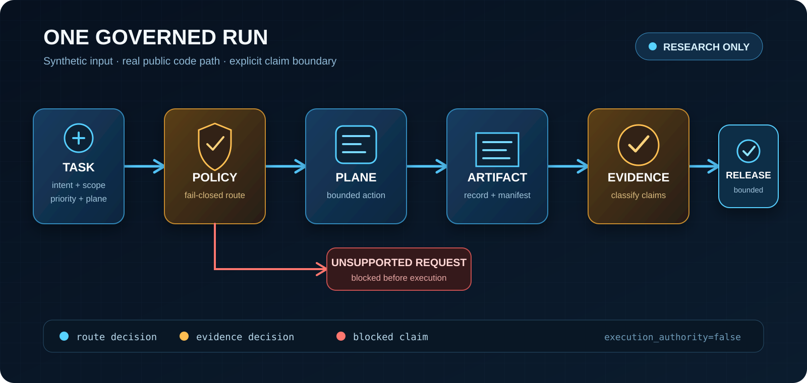

# AIfile

[](https://github.com/Daniel-24-life/AIfile/actions/workflows/public-package-tests.yml)

Current release: [`v2.0`](CHANGELOG.md) (2026-07-30).

AIfile is where I keep the parts of my AI work that can be shown in public.

I do not upload the original workspaces. Each project is rebuilt around four
things I can disclose safely: the system shape, the rules I used, a synthetic
evidence record, and a small piece of code when the code can stand on its own.

## Start here

### [BTC Quant Agent System](showcases/quant-agent-system/)

The BTC package turns the private system's governance rules into a small public
program. Run it to see research, dry-run, promotion, and live requests routed to
`research_only` or `blocked`, with each decision written to JSON.



```powershell
cd shelves/code/agent-governance-skeleton
python public_demo.py
```

## Primary entries

| Project | Operating loop | Evidence and implementation |
| --- | --- | --- |
| [BTC Quant Agent System](showcases/quant-agent-system/) | Research task -> governed evidence decision -> bounded release. | [Demo run](showcases/quant-agent-system/demo-run.fake.json) · [Runnable code](shelves/code/agent-governance-skeleton/) |
| [AIGC Video Production Pipeline](showcases/aigc-video-production-pipeline/) | Creative brief -> review-ready production package. | [Shot review](showcases/aigc-video-production-pipeline/shot-review-sample.md) · [Workflow](showcases/aigc-video-production-pipeline/workflow.md) |
| [Creator Discovery Pipeline](showcases/creator-discovery-pipeline/) | Public signals -> reviewed handoff table. | [Review record](showcases/creator-discovery-pipeline/review-sample.fake.json) · [Runnable code](shelves/code/creator-discovery-skeleton/) |
| [Daily Brief Agent](showcases/daily-brief-agent/) | Source pool -> citation-reviewed brief. | [Brief review](showcases/daily-brief-agent/brief-review-sample.fake.json) · [Runnable code](shelves/code/daily-brief-skeleton/) |
| [Mailbox Governance Agent](showcases/mailbox-agent-system/) | Proposed mailbox action -> policy decision record. | [Decision record](showcases/mailbox-agent-system/decision-sample.fake.json) · [Runnable code](shelves/code/mailbox-governance-skeleton/) |
| [AI Skill Routing Playbook](shelves/skills/ai-skill-routing-playbook/) | Task intent -> bounded and verified route. | [Worked example](shelves/skills/ai-skill-routing-playbook/worked-routing-example.md) |
| [AI Workflow Learning System](shelves/understanding/ai-workflow-learning-system/) | Reading insight -> tested workflow rule. | [Application record](shelves/understanding/ai-workflow-learning-system/application-record.md) · [Handbooks](shelves/understanding/ai-workflow-learning-system/) |

## Operating pattern

```text
problem definition
  -> system model
  -> bounded execution
  -> evidence artifact
  -> human review
  -> release decision
  -> reusable rule
```

The public code concentrates on boundaries and review gates. It is intentionally smaller than the private systems and uses synthetic inputs.

## Verification

Install the test dependency and run every public code package from the repository root:

```powershell
python -m pip install -r requirements-dev.txt
python scripts/verify_public_packages.py
```

The verification entry runs each package in its own working directory. It also
checks synthetic JSON, relative links, release metadata, obvious credential
patterns, and private local paths. GitHub Actions runs the same command on
pushes and pull requests.

### v2.0 verification snapshot

| Check | Result |
| --- | ---: |
| Public projects and method packages | 7 |
| Runnable code packages | 4 |
| Automated tests | 41 passed |
| Synthetic JSON records | 8 valid |
| Markdown files | 65 link-checked |

## Repository layout

| Path | Contents |
| --- | --- |
| [CHANGELOG.md](CHANGELOG.md) | Repository release history and verification snapshot. |
| [showcases/](showcases/) | Project narratives, architecture, boundaries, and evidence samples. |
| [shelves/code/](shelves/code/) | Sanitized code skeletons and tests. |
| [shelves/skills/](shelves/skills/) | AI routing and workflow playbooks. |
| [shelves/understanding/](shelves/understanding/) | Handbooks, application records, and concept cards. |
| [catalog/](catalog/) | Portfolio inventory and classification. |

## Publication boundary

Public packages may include system structure, generalized rules, synthetic records, tests, and reconstructed examples.

They exclude credentials, accounts, real contacts, private source lists, strategy formulas, production prompts, raw logs, real transaction or campaign data, complete automation chains, and private business relationships.
