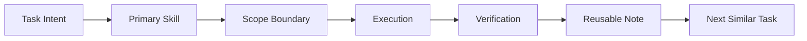

# AI Skill Routing Playbook

This playbook explains how I route AI-assisted work across writing, review, verification, document handling, and publishing without letting every task become a tool-selection mess.

The practical question is:

```text
When AI tools keep multiplying, how do I choose the right entry point, keep boundaries clear, and leave reusable lessons after the task?
```

## Contents

This package covers three parts of my AI operating method:

- task-first skill selection
- boundary control between generation, review, verification, and formatting
- lightweight governance for reusable workflows

## Core Rule

```text
Name the task before choosing the skill.
```

A skill should be selected because the task has a specific shape. A writing task, a review task, a file conversion task, and a publishing task need different entry points. Mixing them too early makes the AI system harder to inspect.

## Public Model



## The Four Questions

Before using a skill, I ask:

1. What is the main deliverable?
2. Is the task about creation, review, verification, conversion, or publishing?
3. What should this skill not do?
4. What will I check before calling the task done?

These four questions keep routing from spreading too loosely. They also make route choices easier to explain.

## Skill Boundary Map

| Work Type | Primary Question | Boundary To Keep |
| --- | --- | --- |
| Writing | What needs to be written or revised? | Do not let writing tools invent facts, sources, or personal experience. |
| Review | What risk or quality issue must be checked? | Do not let review tools silently rewrite the work. |
| Research | What question needs evidence? | Separate search, synthesis, and final writing. |
| Document Work | What file needs to be created or inspected? | Keep formatting work separate from content judgment. |
| Publishing | What is allowed to be released publicly? | Confirm scope, audience, and destination before release. |
| Maintenance | What needs to stay consistent over time? | Do not turn a one-time cleanup into a broad refactor. |

## Working Position

Collecting tools is easy. The useful skill is choosing the right one, setting its stop line, and checking the result.

## Public Files

| File | Purpose |
| --- | --- |
| [Routing Principles](routing-principles.md) | The routing rules I use before selecting a skill. |
| [Writing Boundaries](writing-skill-boundaries.md) | How I separate drafting, editing, review, and style cleanup. |
| [Governance Notes](governance-notes.md) | How I treat reusable workflows and tool conflicts. |
| [Worked Routing Example](worked-routing-example.md) | A sanitized repository publishing route. |
| [Scope](public-scope.md) | Public scope and boundary. |
| [Concept Cards](cards/) | Short reusable concept cards. |

## Status

Status: `approved_for_public_v1`

This is the public method layer of a larger private working environment.
