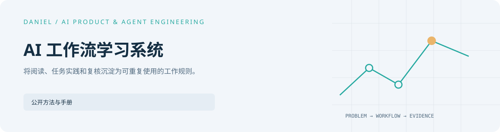

<picture>
  <source media="(prefers-color-scheme: dark)" srcset="../../../assets/projects/ai-workflow-learning/cover-dark.svg" />
  
</picture>

# AI 工作流学习系统

[English](README.en.md) · [完整作品目录](../../../README.md)

将阅读、任务实践与复核沉淀为可再次使用的工作规则。读到的观点先进入任务，
检查实际结果，再决定是否保留。

## 方法与材料

工作循环为阅读、问题定义、工作流、证据、复核、复用。
知识、标准和战术分别对应事实理解、交付边界和任务顺序。

[中文使用手册](AI使用手册.md) · [英文使用手册](AI-Usage-Handbook.md) · [实践记录（英文）](application-record.md) · [概念卡片（英文）](cards/)

原始文章、长摘录、私有草稿和 OCR 原材料保留在本地。公开内容是个人方法与实践记录，
不包含第三方原文合集或可验证的通用能力评分。
