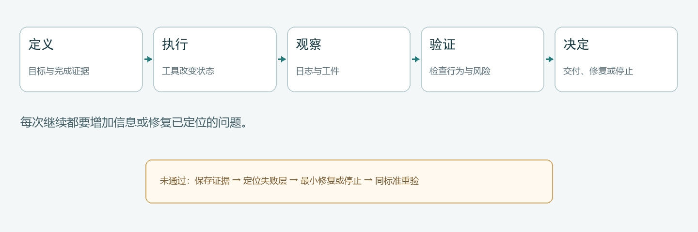
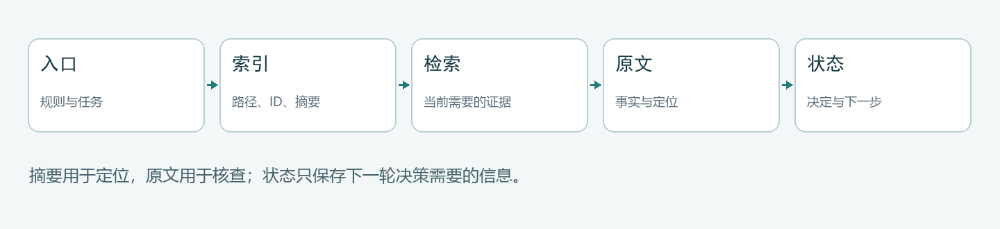

# AI 工具提效与 Agent Harness 使用手册

版本：v2.4  
日期：2026-10-28  
交付：Markdown + 本地网页 + PDF  
定位：从“能让 AI 运行代码”走向 Agent 工程，理解机制、完成工作，并思考 AI 时代的个人价值与社会变化

> Agent 把理解、判断和工具操作连接成一项工作。本手册从这些部件怎样协同出发，解释如何把需求变成结果，再将一次任务中的经验积累为长期能力。

<a id="ch0"></a>
## 0. 使用这份手册

### 0.1 按你要完成的动作进入

| 你现在要做什么 | 直接阅读 | 最终应得到什么 |
| --- | --- | --- |
| 第一次建立完整认识 | 第 1 章起连续阅读 | 能解释 Agent 如何执行、验证和停止 |
| 把模糊要求交给 Agent | 1.3、1.4、附录 B | 可执行任务规格与验收条件 |
| 接入 CLI、API、MCP 或界面 | 第 2 章 | 工具契约、权限和失败语义 |
| 材料很多、上下文总是不够 | 第 3 章 | 信息分层、检索与 Skill 方案 |
| 任务很长，担心中断或重复 | 第 4 章 | 检查点、状态文件和恢复入口 |
| 想知道改进是否真的有效 | 第 5 章 | 分层评测、失败归因和成本基线 |
| 考虑拆成多个 Agent | 第 6 章 | 拆分条件、任务契约和共享状态 |
| 把一次成功变成长期流程 | 第 7 章 | 脚本、回归集和候选改进闭环 |
| 讨论 AI 时代、财经或政治政策 | 第 8 章 | 理解技术、工作、收益与制度的关系，形成自己的判断 |
| 查 Codex / Claude Code 差异 | 附录 A | 产品入口与操作关系 |
| 直接复制模板 | 附录 B | 任务、状态、工具、评测和交接模板 |
| 进一步阅读原始材料 | 附录 C | 章节—来源映射与阅读记录 |

一项可靠的 Agent 任务最终都要完成六个动作：

```text
理解机制 → 选择方案 → 执行任务 → 验证结果 → 定位失败 → 沉淀经验
```

主文沿这些动作推进。第 8 章从技术能力怎样进入工作出发，讨论个人价值、经济收益与政策选择；产品配置、可复制模板和来源分别放入附录。

### 0.2 连续阅读与快速查用

第一次阅读可以沿主文理解各部件的关系，再选一项熟悉的任务练习。遇到具体问题时，按上表进入对应小节；需要开始执行时，复制附录 B 的模板并填写自己的材料。

每章围绕一个主要认识展开：解释为什么，再通过案例走到应用。进阶部分补充实现细节，附录 C 保留来源、阅读范围与运行记录，方便继续深入。

### 0.3 任务地图

```text
用户目的
  ├─ 定义完成证据 ──→ 任务规格与风险边界
  │                         │
  ├─ 选择工具与权限 ──→ 执行、观察、记录
  │                         │
  ├─ 分层验证 ←──────── 工件、日志、测试、原始证据
  │       ├─ 通过 ──→ 结构化交付与经验沉淀
  │       ├─ 可定位失败 ──→ 最小修复后重验
  │       └─ 缺输入/权限/判断 ──→ 保存状态并停止
  └─ 任务重复且稳定 ──→ 脚本 / Skill / 自动化候选
```

### 0.4 核心术语

| 中文与英文 | 在本手册中的含义 |
| --- | --- |
| 智能体（Agent） | 根据目标和当前证据选择动作、调用工具并决定继续或停止的执行系统 |
| 运行支撑层（Harness） | 把模型、指令、上下文、工具、权限、状态和验证组织起来的工作环境 |
| 工具契约（tool contract） | 工具的输入、输出、副作用、权限、错误和重试规则 |
| 状态（state） | 下一轮决策或恢复任务所需的最小充分信息 |
| 上下文工程（context engineering） | 决定哪些信息在什么时刻进入、保留、压缩或移出模型窗口 |
| 能力包（Skill） | 带触发条件、步骤、资源和边界的可复用流程 |
| 检索增强生成（RAG） | 先从外部知识源取回证据，再让模型基于证据回答 |
| 幂等性（idempotency） | 同一请求被重复执行时不会产生额外副作用的性质 |
| 评测（evaluation / eval） | 用样本和指标判断成功、定位失败并比较改进 |
| 多智能体（multi-agent） | 多个 Agent 通过任务契约和共享工件完成可拆分工作 |

---

<a id="ch1"></a>
## 1. 可验证的单 Agent 工作流

### 1.1 第一性问题：什么叫“完成”

完成一项任务，就是让当前状态达到用户需要的目标状态。例如，修复登录功能要让相应用户能够进入系统，整理文章要让材料变得可读、可查和可复用。命令、代码与文档都参与这个变化过程。

可以从三类对象理解一项任务：

1. **目标状态**：用户真正想得到什么。
2. **当前状态**：系统、文件、数据或知识现在是什么样。
3. **允许的状态变化**：Agent 可通过哪些工具，在什么权限下，把当前状态变成目标状态。

验证回答“目标变化发生了吗”。我们据此决定交付、调整方案，或者继续执行。记录当前状态与工具结果，则帮助下一轮找到最有用的动作。

这套方法适用于代码、数据、研究、浏览器操作和文档加工。本章用 PDF 转换展示完整过程，再说明怎样迁移到其他任务。

### 1.2 单 Agent 循环的六个部件

```text
任务规格 → 当前状态 → 下一步判断 → 工具执行 → 新观察 → 验证与停止
    ▲                                                     │
    └──────────────── 失败定位与最小修复 ────────────────┘
```

| 部件 | 要解决的问题 | 典型载体 |
| --- | --- | --- |
| 任务规格 | 要改变什么，不能破坏什么 | 一段任务说明或 `task-spec.md` |
| 当前状态 | 已确认什么，尚缺什么 | 对话、状态文件、进度记录 |
| 下一步判断 | 哪个动作最可能增加证据 | 模型推理与计划 |
| 工具执行 | 怎样接触真实系统 | CLI、API、SDK、MCP、浏览器 |
| 新观察 | 外部世界实际返回了什么 | 退出码、文件、日志、页面状态 |
| 验证与停止 | 证据是否足够，是否继续 | 测试、检查器、人工门禁 |

一次循环后只有四种合理选择：证据充分，交付并停止；证据指出具体缺陷，最小修复后重验；证据不足但存在安全取证动作，继续获取信息；缺少权限、关键输入或人工判断，保存状态并停止等待。



```python
while True:
    evidence = observe_current_state()
    decision = evaluate(evidence, acceptance_criteria)

    if decision.is_complete:
        deliver(evidence)
        break
    if decision.needs_user_or_permission:
        save_state_and_stop(decision)
        break
    if not decision.next_action_adds_information:
        record_unresolved_and_stop(decision)
        break

    result = execute(decision.next_action)
    record(result)
```

每轮工具结果都应改变下一步选择：文件已经生成，就进入内容检查；日志指出某个参数错误，就修正参数；环境缺少组件，就先补齐环境。循环的价值来自利用反馈，让每一步更接近目标。

### 1.3 先设计完成证据，再设计步骤

先写“完成时必须看到什么”，再倒推动作。通用验证栈分四层：

| 验证层 | 回答的问题 | 常见证据 | 下一步看什么 |
| --- | --- | --- | --- |
| 运行 | 工具是否执行完 | 退出码、日志、进程状态 | 输出文件与关键日志 |
| 工件 | 输出是否完整且结构正确 | 文件、schema、哈希、链接 | 代表场景中的表现 |
| 行为 | 代表性场景是否有效 | 测试、实际运行、界面操作、样本对账 | 结果怎样用于实际工作 |
| 用途与边界 | 是否满足用途，动作是否符合约定 | 使用反馈、业务条件与操作记录 | 可交付结果与剩余问题 |

验证深度跟随任务变化。改一句内部说明，检查表达和链接即可；修改付款逻辑，需要测试、沙箱运行、权限确认和人工批准。选择那些能回答当前关键问题的检查，让验证帮助任务向前推进。

把模糊要求改成可观察条件：

- “页面好用”改为“窄屏下导航可打开，表格可横向滚动，复制失败时不虚报成功”。
- “数据准确”改为“输出行数符合去重规则，金额汇总与基准相等，异常行另表保存”。
- “修复登录问题”改为“失效会话进入登录页，有效会话仍能访问原页面，相关测试通过”。

### 1.4 通用任务规格

简单任务可以写成一段；复杂、长时间或需要交接的任务，再保存成独立文件。

```markdown
任务目的：
[最终要解决的问题，以及结果将怎样被使用]

输入与当前状态：
- 输入：[文件、目录、仓库、页面或数据]
- 已知事实：[已经确认的条件]
- 未知项：[需要通过工具或人工确认的内容]

允许范围：
- 可以修改：[明确路径或系统]
- 不得修改：[原始材料、生产环境、长期规则等]
- 需要确认：[外部发送、发布、删除、真实交易等动作]

交付物：
- [文件、代码、报告、界面状态或结构化结果]

完成标准：
1. [可观察的结果]
2. [必须保持的不变量]
3. [需要运行或人工查看的验证]

失败处理：
- 保留原始输出和日志，再定位失败层。
- 只有新尝试能增加信息、改变路径或修复已定位问题时才重试。
- 无法确认时停止，列出缺少的输入、权限或判断。

交付时说明：完成了什么、证据是什么、没有验证什么、下一步是什么。
```

长期规则与当次任务分开。项目反复使用的权限边界、测试命令和目录约定进入 `AGENTS.md`、`CLAUDE.md` 或 Skill；本次路径、目标和交付物留在任务规格中。

### 1.5 脚本、工具、模型和人的分工

| 工作类型 | 优先负责者 | 为什么 | 例子 |
| --- | --- | --- | --- |
| 可重复机械检查 | 脚本 | 稳定、便宜、可回归 | 测试、schema、行数、字符扫描 |
| 文件与系统操作 | 工具 | 真正接触外部状态 | 读写、命令、API、浏览器 |
| 根据证据选择路径 | 模型 | 需要理解上下文和取舍 | 是否换解析器、先查哪份日志 |
| 价值、语义与风险判断 | 模型加人工 | 完成标准含主观或业务含义 | 内容是否值得采用、是否可发布 |
| 高风险最终动作 | 人工授权与确定性门禁 | 工具能力不等于业务权限 | 发布、外发、删除、生产写入、交易 |

```json
{
  "status": "pass | needs_review | fail",
  "evidence": ["工件或检查结果"],
  "unverified": ["当前证据没有覆盖的项目"],
  "next_action": "下一步动作；没有则为 null",
  "stop_reason": "停止原因；继续时为 null"
}
```

`needs_review` 表示需要进一步查看的情况。例如检测到无文字页后，下一步查看页面图像，再决定它是空白尾页还是提取遗漏。这个状态把异常转成了一个具体的后续动作。

### 1.6 动作—观察—判断—下一步

```markdown
动作：[运行了哪个命令或调用了哪个工具]
观察：[退出码、关键日志、文件或界面变化]
判断：[观察支持或否定了哪个完成条件]
下一步：[继续、修复、请求确认或停止；写明理由]
```

测试退出 `1`、日志显示旧接口断言失败，这是观察。“改动破坏了兼容性”是解释，需要再核对失败测试与改动的关系。观察和解释分开，状态记录才不会把推测固化成事实。

### 1.7 失败诊断：先定位层次

| 失败层 | 常见信号 | 先检查什么 | 合理恢复 |
| --- | --- | --- | --- |
| 任务理解 | 产物与用途不符 | 目标、边界、示例 | 重写规格，确认歧义 |
| 环境与权限 | 命令不存在、拒绝访问、缺凭据 | 环境、路径、授权范围 | 补前置条件或请求授权 |
| 工具执行 | 非零退出、超时、协议错误 | 原始日志、参数、输入 | 修正调用或换工具 |
| 工件结构 | 文件缺失、schema 错、链接断 | 输出目录、机械检查 | 修复生成逻辑并重验 |
| 行为与保真 | 测试失败、结果与源证据不一致 | 代表样本、原始材料 | 定位差异，最小修复 |
| 语义与用途 | 形式正确但不解决问题 | 用户目标、来源、业务条件 | 调整方案或交回人工 |

重试必须改变输入、参数、工具、环境或验证方式。若没有能增加信息的动作，就应停止并披露阻塞。

### 1.8 完整案例：PDF 转换怎样暴露通用问题

把 PDF 整理为 Markdown，要处理正文、图片、空白页和字符编码。预览包保存了正常输入、空白尾页和含 NUL 不可见字符的隔离副本。脚本负责复制、转换和定位异常；模型结合原页理解问题，选择合适的恢复路径。

```powershell
Set-Location -LiteralPath './output/handbook_v2_preview'
python '.\scripts\run_demo.py'
```

| 样本 | 工具观察 | 判断 | 下一步 |
| --- | --- | --- | --- |
| 正常 PDF | 9 页、9 图、无断链和控制字符 | 结构完整 | 对照正文与图像 |
| 空白尾页 | 第 8 页没有文字或图片块 | 需要了解源页内容 | 查看第 8 页原图 |
| 异常字符原稿 | 28 页、25 图、18 处 NUL | 明确违反字符条件 | 定位字符并对照原页 |
| 修复稿 | 控制字符为 0，图片仍可用 | 字符问题已处理 | 保留原稿，对照修复位置 |

```python
def find_control_characters(text):
    pattern = r"[\x00-\x08\x0b\x0c\x0e-\x1f\x7f]"
    return [
        {"offset": m.start(), "code": f"U+{ord(m.group()):04X}"}
        for m in re.finditer(pattern, text)
    ]
```

字符扫描负责定位，源页负责提供上下文。把两者结合起来，Agent 就能理解缺失位置、选择修复内容，并保留改动依据。

```json
{
  "no_text_pages": [8],
  "confirmed_blank_pages": [],
  "pending_blank_pages": [8],
  "mechanical_status": "pending_review",
  "semantic_review": "not_assessed_by_this_script"
}
```

查看原页确认确实为空后，再把 `confirmed_blank_pages: [8]` 传给检查器。如果原页有内容，就改用 OCR、页面图像或布局解析补齐，而不是删除异常标记。

从这个案例可以提炼出一条通用路径：先让脚本找出差异，再让模型结合上下文解释原因，最后对修复位置运行原有检查。原稿保留了恢复起点，也方便理解每次改动。

### 1.9 迁移到常见任务

| 场景 | 工具执行 | 关键验证 | 失败后的原始证据 |
| --- | --- | --- | --- |
| 修改代码 | 编辑、构建、测试 | 目标测试、相关回归、实际运行 | diff、失败栈、日志 |
| 处理数据 | 读取、转换、导出 | schema、行数、对账、不变量 | 原始行、中间值、质量报告 |
| 技术研究 | 检索、读取、整理 | 原文阅读、主张—来源映射、时效性 | 页面、访问状态、引用位置 |
| 浏览器自动化 | 导航、填写、提交 | 页面状态、写入结果、权限和副作用 | 截图、响应、操作日志 |
| 文档转换 | 提取文字和图像 | 页数、链接、保真、语义完整 | 原 PDF、页面渲染、原始稿 |

迁移时保留执行循环，按领域选择完成条件和原始材料。代码任务看目标行为，数据任务看规则与对账，研究任务看解释与来源。

### 1.10 结构化交付

交付先说明完成了什么，提供成果入口与必要的运行结果；需要继续时，留下明确入口。可复制格式集中在附录 B.8。

---

<a id="ch2"></a>
## 2. 工具、接口与执行权限

### 2.1 工具是受约束的状态转换

工具让模型能够读取信息、操作文件并与外部系统交互。一次调用可以理解为状态转换：接收输入，在特定身份与权限下执行，返回结果或错误。设计工具时，把输入、作用对象、成功结果和失败路径说明白，Agent 才容易选择和组合它。

例如，把报表导出工具设计成“接收日期范围，返回文件路径、行数和异常列表”，模型就能据此继续汇总或解释异常。输入输出越贴近一项完整动作，后续编排越清楚。

### 2.2 CLI、API、SDK、MCP 与界面自动化

| 方式 | 适合 | 优势 | 主要风险 |
| --- | --- | --- | --- |
| CLI | 本地、批处理、脚本化任务 | 易记录、组合和回归 | 输出格式可能不稳定，身份继承不清 |
| API | 稳定系统集成 | 契约明确、便于测试 | 认证、版本、限流和幂等需设计 |
| SDK | 语言内深度集成 | 类型、重试和对象模型方便 | 版本耦合，可能隐藏网络行为 |
| MCP | 向 Agent 宿主统一暴露工具和资源 | 发现与调用方式统一 | 宿主实现、授权和工具质量不同 |
| 浏览器/桌面自动化 | 只有界面或必须通过界面的系统 | 覆盖无 API 场景 | 布局脆弱、状态难确认、写入风险高 |

选择接口时，先看系统已有能力和任务特点。批量处理依赖工具提供批量输入与逐项结果；MCP 则统一工具发现和调用方式。把业务动作、接口能力和连接协议分开理解，更容易找到需要改造的环节。

### 2.3 工具契约

```yaml
name: convert_documents
purpose: 将隔离副本转换为 Markdown 并生成质量报告
input:
  paths: absolute_path[]
  output_dir: absolute_path
side_effect: writes_files
permissions:
  read: input paths
  write: output_dir only
output:
  status: pass | needs_review | fail
  artifacts: path[]
  checks: object
errors:
  invalid_input: 不应重试
  transient_io: 限次重试
  permission_denied: 请求授权或更换范围
idempotency: 相同输入与版本生成相同目标；覆盖前保留原稿
verification: schema + links + control characters + representative source review
```

自然语言说明帮助模型选择工具，结构化 schema 约束参数，执行层落实权限与业务规则。三层共同把一个意图转成可以执行和解释的动作。

### 2.4 风险分级

| 风险级 | 示例 | 默认策略 |
| --- | --- | --- |
| L0 纯推理 | 解释本地已给内容 | 直接执行 |
| L1 只读 | 搜索、读文件、查状态 | 在授权范围内执行并记录来源 |
| L2 可逆写入 | 编辑工作区、创建草稿 | 限定路径、保留 diff、执行验证 |
| L3 外部或难恢复写入 | 发信、发布、生产配置 | 明确授权、预览、结果确认 |
| L4 高后果操作 | 删除数据、交易、权限变更 | 人工门禁、最小权限、审计和恢复方案 |

风险不只由工具名决定。同一个数据库查询可能是 L1，也可能因敏感数据需要更严格控制；同一个 `git` 命令可以只是查看，也可以覆盖历史。

### 2.5 超时、重试、幂等和不确定结果

超时只说明调用者没有及时收到结果，不等于操作没有发生。写入类工具重试前必须查询真实状态，或使用幂等键。

```text
保存请求标识和参数
→ 查询目标系统当前状态
→ 判断操作未发生 / 已完成 / 结果不确定
→ 只有能证明安全时才重试
→ 把不确定结果升级为人工复核
```

暂时性网络错误可以有限退避重试；参数错误、权限拒绝和业务冲突，原样重试没有意义。重试预算同时限制次数、总时间和可能副作用。

### 2.6 老系统接入

接入前确认受支持的 API/CLI/SDK、文档完整度、身份与业务权限如何传递、系统能承受多大变更和失败风险。

1. 有稳定 API：优先使用原接口，按宿主需要增加 MCP 适配。
2. 有 CLI/SDK/脚本：包装成参数明确、输出结构化、错误可识别的工具。
3. 只有界面：评估浏览器或桌面自动化，并记录布局依赖和失败确认方式。

适配层保持薄：负责协议、参数、结果与错误转换；业务规则和权限继续由原系统负责。试点先选高频、低风险、收益可测的读取任务，再逐步进入写入。

### 2.7 用小任务完成工具接入

先用一个正常任务走通输入、执行与结果，再观察缺字段、越界值和恶意输入怎样处理。身份与业务权限在实际执行点落实，日志保留定位所需的信息，并保护凭据和敏感内容。

随后关注超时、部分失败与重复请求：结果应准确表达当前状态，让 Agent 知道怎样继续、修复或停止。完成这条小链路后，再扩展工具覆盖的任务范围。

---

<a id="ch3"></a>
## 3. 上下文、Skill 与检索

### 3.1 让信息服务于下一步判断

上下文工程要解决的是：在正确时刻让模型看到足以做当前决定的信息。修复错误时需要相关代码和失败日志，选择研究方向时需要问题、材料与团队条件。围绕下一步安排信息，才能减少反复解释和无关读取。常见信息可以分为七类：

| 资产 | 例子 | 何时进入 | 何时移出或压缩 |
| --- | --- | --- | --- |
| 稳定指令 | 项目规则、权限边界 | 会话开始或按作用域发现 | 规则版本变化 |
| 当前任务 | 目标、输入、完成标准 | 本次任务开始 | 任务结束 |
| 短期状态 | 已完成、下一步、失败日志 | 当前阶段 | 被结论与定位替代后 |
| 长期记忆 | 已确认偏好、稳定方法 | 与任务相关时检索 | 过期、冲突或撤销 |
| 即时检索 | 原文片段、代码位置 | 当前判断需要时 | 结论写入后保留定位 |
| 工具定义 | 名称、schema、权限 | 工具可用时 | 工具不可用或无关时 |
| 输出契约 | JSON schema、报告格式 | 生成或交接前 | 交付结束 |

每类资产都要回答：什么时候进入窗口、保留多久、何时压缩、由什么证据更新。

### 3.2 渐进式披露

入口只提供分流所需信息，细节按需读取：

```text
项目入口规则
  ├─ 当前任务规格
  ├─ 相关 Skill 说明
  │    ├─ reference A
  │    └─ script B
  ├─ 文件/代码索引
  └─ 当前步骤需要的原文或日志
```

路径、ID、标题和摘要帮助模型找到材料；需要解释具体细节时，再读取对应原文。例如先用目录定位失败日志，再读取报错附近的内容，比每轮加载全部日志更集中。



### 3.3 Prompt、长期规则和 Skill 的边界

| 载体 | 放什么 | 不宜放什么 |
| --- | --- | --- |
| 当前 Prompt / 任务规格 | 本次目标、输入、临时约束 | 所有历史经验和大段通用说明 |
| `AGENTS.md` / `CLAUDE.md` | 项目长期规则、目录、验证和权限 | 一次任务的路径和目标 |
| Skill | 可重复、有明确触发和步骤的能力包 | 未验证的单次技巧、无限范围知识库 |
| 脚本 | 确定性操作和检查 | 需要模糊语义判断的策略 |
| 参考资料 | 深层原理、产品差异、长示例 | 每次强制加载的入口规则 |

做 Skill 不看固定次数，而看三个信号：需求会重复；步骤和输入输出足够稳定；已有样本能验证它比临时操作可靠。一次任务也可能值得立刻 Skill 化，例如复杂安装步骤已稳定复现；做了很多次仍不稳定的流程，也不该急着固化。

### 3.4 信息选择：先精确定位，再语义检索

1. 已知路径、主键、错误码或函数名：文件系统、数据库、全文搜索。
2. 知道主题但不知道用词：语义检索。
3. 同时要求语义相关和精确命中：混合检索。
4. 受租户、权限、时间、状态限制：候选生成时加入元数据过滤，并在返回前再次鉴权。

向量存储擅长发现“表达不同但语义相近”的材料。路径、主键与错误码明确时，精确搜索更直接；主题模糊时，语义检索可以补充候选。先看信息怎样被使用，再选择存储和检索方式。

### 3.5 检索增强生成的最小闭环

写入链路：

```text
原始内容 → 解析与切分 → Embedding → 向量、文本和元数据
        → 建立索引 → 记录来源、权限和版本
```

查询链路：

```text
理解问题与约束
→ 生成查询并前置权限/时间过滤
→ 向量检索与全文检索
→ 融合或重排
→ 返回前二次权限校验
→ 根据定位取回原文
→ 注入足以回答问题的证据
→ 回答并记录采用来源
```

一条记录至少保留稳定 ID、可回溯文本、源位置、权限与租户、时间、embedding 版本。向量索引找候选，原始文件或业务数据库仍可作为事实源。

若先取 TopK 再做权限或业务过滤，大量候选可能被排除，真正合格的结果又没有进入最初 TopK。能在候选阶段处理的约束应尽量前置；返回前仍要二次鉴权，作为防御边界。

<details>
<summary>进阶：切分、TopK、重排与索引选型</summary>

### 3.6 切分、TopK 和重排不是越大越好

切分过小会丢上下文，过大则召回噪声并增加 token。`TopK` 太小可能漏证据，太大可能把相关内容淹没。使用自己的问题集比较：

- 必须召回的来源是否进入候选；
- 第一个正确结果排名；
- 过滤后还有多少有效候选；
- 片段能否独立支持结论；
- 生成是否真正使用证据；
- 延迟、token 和单次成本。

HNSW、DiskANN、IVF 等索引路线没有脱离数据规模、更新方式、内存与延迟目标的“最好”。应在相同召回目标下比较 P50/P95 延迟、吞吐、构建时间、更新新鲜度、存储和总成本。

</details>

### 3.7 把研究材料组织成可继续思考的背景

研究材料的作用，是帮助我们提出解释、比较选择并形成判断。把核心问题、重要材料、当前认识和仍想深入的部分放在一起，下一轮讨论就能沿已有思路推进。来源位置放在旁边，便于需要细节时回看。

| 来源 | 适合支持什么 | 使用限制 |
| --- | --- | --- |
| 官方文档、规范、论文原文 | 产品行为、协议、原始结论 | 核对版本和日期 |
| 原始实现、仓库、issue、release | 工程事实、实际限制 | 热度不等于正确或适用 |
| 公司工程博客、作者实践 | 案例、故障和表达方法 | 不把局部效果外推为规律 |
| 社区讨论 | 发现问题、语言和反例 | 回到原始证据后再下结论 |

```markdown
| 主张 | 原始来源与位置 | 类型 | 核查日期 | 适用条件 | 状态 |
| --- | --- | --- | --- | --- | --- |
|  |  | 官方/实现/案例/观点 |  |  | 已核查/待验证 |
```

### 3.8 上下文优化速查

- 先测量 token、工具返回量、轮次和失败重试，再谈优化。
- 只暴露当前角色需要的工具和材料。
- 工具原始输出被消化后，保存结论与证据位置，不反复粘贴全文。
- 稳定规则与动态状态分离。
- 压缩前外置事实、决定、未完成项和定位。
- 长上下文效果取决于模型、任务和信息布局，用回归集验证，不做绝对承诺。

---

### 3.9 让背景可复用，也让它可以失效

上下文复用的价值，是让下一项任务更容易开始。每次找文件、解释项目、补充偏好，都需要注意力。把这些背景安排在合适的位置，Agent 就能更快进入工作的实质部分。

先观察一个重复任务，把补充信息分为三类：跨任务稳定的信息进入项目说明；当前任务的信息进入状态文件；会变化的事实附上来源与时间。下一次从这些背景继续，集中讨论会影响结果的新问题。

例如每周生成项目进展稿：受众、语气和交付目录可复用，本周里程碑与负责人从最新记录读取，发布按当次安排进行。背景记录随项目变化更新，才能持续帮助工作。

可复用背景应带上提供者、适用范围与更新时间，并允许更正或停用。出现冲突时，回到当前任务指定的材料，说明差异后调整。这样既能积累背景，也能跟上实际变化。

可以用同类任务观察变化：准备输入是否更省力，重复补充是否减少，旧信息是否及时更新，结果是否更贴近用途。可复制记录格式见附录 B.10。

这部分思路受 Personal Agent 访谈启发，延伸阅读见附录 C.7。

### 3.10 用下一步决策衡量上下文的价值

上下文窗口是模型本次推理能够直接使用的工作空间。任务的完整历史往往比它大，而下一步只需要其中一部分。因此，上下文工程首先是在有限空间里选择信息：哪些内容会改变当前行动，哪些内容可以在需要时再读取？

设想让 Agent 比较两家物流服务商。当前要判断报价差异，就需要相同线路、重量、附加费和时效口径；早期讨论过的网页配色暂时无用。若摘要只留下“甲更便宜”，却丢掉甲不含偏远附加费这一条件，文字虽然变短，下一步选择却可能变差。压缩质量因此要看任务能否继续正确推进。可以用同一个继续任务比较：恢复后能否找到关键条件、解释先前决定、完成下一步，以及用了多少读取与纠错成本。

这也解释了三种常用安排的关系：摘要帮助迅速定向，工作笔记组织当前目标、决定和待办，原始历史提供详细证据。它们共同支持“先知道去哪找，再读取需要的部分”。摘要留下稳定路径或条目标识，笔记链接到原始材料；遇到冲突时沿链接回到具体内容。对于很短、一次完成的任务，保留完整上下文通常就够了，无需另建多层系统。

维护这些材料需要分工。脚本适合保存文件、记录时间、建立索引和检查路径；模型适合判断某个条件为何重要、几项观察怎样联系，以及下一步还缺什么。模型写下的解释附着在原始观察上，后续才容易更正。

这一组织方式受 Codex 架构文章的跨窗口设计启发。它可以通过普通项目文件实现；产品内部的具体记忆接口与版本差异见附录 C.10。

<a id="ch4"></a>
## 4. 状态、记忆与长任务恢复

### 4.1 状态是恢复执行所需的最小充分信息

长任务需要把进展从对话中保存下来。状态记录的作用，是让下一次会话知道目标、已完成的工作、关键决定、当前问题和继续入口。保存这些能影响下一步的信息，恢复时就能接着做。

可以把状态理解为任务的工作台：已经处理的材料放到成果区，重要决定附上理由，下一步要用的输入留在手边。聊天记录保留过程，状态文件组织继续工作所需的内容。

```markdown
当前目标：[仍然有效的目标]
完成定义：[可观察标准]
已完成：[动作和生成物路径]
已确认事实：[证据支持的结论]
验证结果：[通过、待复核和失败项]
未完成：[具体问题]
已尝试：[避免无信息重复]
恢复入口：[下一条命令、文件或待确认问题]
权限与风险：[仍需人工授权的动作]
```

### 4.2 临时状态、长期记忆与经验资产

| 类型 | 生命周期 | 例子 | 更新规则 |
| --- | --- | --- | --- |
| 执行状态 | 当前任务 | 进度、失败日志、下一步 | 每个关键阶段更新 |
| 检查点 | 可恢复阶段 | 工件版本、哈希、测试结果 | 状态稳定且验证后写入 |
| 已确认事实 | 跨阶段 | 接口约束、源文件位置 | 有来源、时间和作用域 |
| 个人偏好 | 跨任务 | 输出语言、常用格式 | 用户明确或反复确认 |
| 可复用经验 | 跨任务 | 检查器、模板、Skill | 通过样本和回归后生效 |

不同信息采用不同生命周期。某次失败的处理方法先随任务保存，复用时再判断它适合哪些情况；稳定经验进入模板或 Skill，并保留更新时间与更正入口。

### 4.3 检查点与幂等恢复

好的检查点包含输入版本、已完成阶段、工件路径、验证结果和继续命令。恢复时从这些记录了解外部状态，再找到需要继续的位置：

```text
读取检查点
→ 确认输入和工具版本是否变化
→ 核对工件是否存在且哈希/结构一致
→ 查询外部写入的真实状态
→ 从第一个未验证阶段继续
```

脚本尽量把中间工件写到独立目录，最终产物通过验证后再切换；重复运行要么产生相同结果，要么明确拒绝覆盖。

### 4.4 长任务分段

阶段边界围绕有用的成果划分。例如：资料清单、转换稿、文章认识、完整章节和最终阅读版。每一段都应为下一段提供明确输入，并留下继续入口。这样即使换窗口或暂停，也能从一个完整成果继续。

对话压缩或换窗口前，至少保留：当前目标与约束；已完成项和工件定位；关键决定及理由；失败尝试和原始证据；未完成项、下一步和所需权限。

### 4.5 重试、降级与停止预算

- **重试**：暂时性错误，且重试安全。
- **修复**：已定位到输入、参数、代码或环境缺陷。
- **降级**：主路径不可用，但替代路径仍满足核心目标，并披露能力损失。
- **回滚**：新状态违反不变量，且存在已验证恢复点。
- **停止**：缺少权限、关键输入或可靠确认方式。

为任务设置最大重试次数、最大总时长、最大成本、允许修改范围和人工确认节点。预算是停止条件，不是要求 Agent 把预算全部用完。

### 4.6 让下一位执行者容易接手

交接说明围绕“接下来怎样做”组织：目标和主要决定放在开头，成果附上路径，继续命令带上工作目录，尚缺的信息写成具体问题。涉及外部系统时注明最近状态与可执行范围，让接手者能顺着已有工作推进。

### 4.7 跨窗口交接：把恢复做成一次小型启动

一次长任务至少包含三种不同状态：模型正在读什么，项目文件已经变成什么，外部世界实际发生了什么。换上下文窗口主要改变第一种；生成的文件、已提交的任务或外部操作不会随之清空。恢复执行要把这三者重新对齐。

可以在项目目录维护一个简短入口、几份工作笔记和原始记录。入口回答目标、当前位置和下一步；笔记按主题保存决定、理由、待办和成果路径；原始记录保留输入、命令输出与时间。用户临时调整目标时，先更新入口及受影响决定，避免新窗口沿旧计划继续。可复制格式见 B.12。

以报价比较为例，交接时写下“已统一计费重量，甲缺偏远费口径，下一步读取报价单第 3 页并补齐比较表”。接手后先确认报价版本，再查看表格和那一页。若文件已更新，就重新计算受影响部分；若外部询价仍在等待，就记录等待状态。这样恢复的工作量取决于当前疑点，而不是全部聊天长度。

同理，一个操作返回超时，只说明没有及时收到结果。接手后先查询它是否已经完成，再决定重试。文件写入可以检查目标内容，外部任务可以按任务标识查询；无法查询的操作应保留明确的“结果未知”状态。

交接是否有效，可以通过一次实际恢复来观察：只读入口和必要材料，能否说清下一步并执行。若每次都要通读历史，说明入口缺定位；若频繁沿旧决定行动，说明状态更新与失效处理需要改善。

---

<a id="ch5"></a>
## 5. 评测、调试与成本

### 5.1 用评测找到值得改进的环节

评测的价值，在于帮助我们选择下一项改进。任务理解、工具调用、结果生成和实际使用是不同环节，需要不同观察。例如回答遗漏关键信息，可能需要改善检索；代码无法运行，可能需要补环境或修实现。把结果放回执行链路，改进才更集中。

| 层 | 典型指标 | 失败后先改什么 |
| --- | --- | --- |
| 任务理解 | 需求覆盖、边界误解 | 规格、示例、澄清门槛 |
| 工具选择 | 成功率、无效调用、参数错误 | 工具说明、schema、路由 |
| 工件结构 | schema、链接、格式、完整性 | 生成逻辑、检查器 |
| 行为 | 测试通过、对账、不变量 | 实现、输入、环境 |
| 证据使用 | 来源命中、引用一致、不确定性 | 检索、上下文、生成约束 |
| 权限与风险 | 越权率、误写入、确认遗漏 | 权限模型、门禁 |
| 恢复 | 恢复成功率、重复副作用 | 检查点、幂等、状态记录 |

### 5.2 建立最小回归集

从实际任务收集正常、边界、已知失败和权限处理等样本。每个样本包含输入、期望行为、重要条件与验证方式。可以先用 10—30 个有代表性的样本，覆盖最常见和最值得关注的问题。

失败轨迹尤其适合积累为回归样本：从错误工具调用、缺失信息或过早停止中提炼一个小问题，就得到下一次改进可以使用的材料。

### 5.3 确定性检查与语义评审

确定性检查回答明确不变量：代码能否构建、JSON 是否符合 schema、链接是否存在、金额是否守恒。语义评审判断目标覆盖、解释质量和证据是否足够。

模型适合辅助比较解释质量、覆盖程度和表达效果。给出明确标准（rubric）与代表样本，让它指出具体段落及理由，再抽样和人工意见对照。涉及数值、程序行为或高影响动作时，结合计算、运行结果和负责人决定。

### 5.4 调试顺序

```text
复现问题
→ 固定输入、版本和环境
→ 保留原始观察
→ 判断最早出现偏差的层
→ 做单一、最小改动
→ 重跑目标检查和相关回归
→ 比较质量、成本和副作用
```

检索没有召回正确来源，先改切分、索引、过滤或查询；候选存在但排序差，改融合与重排；证据正确但回答错，才改 Prompt、模型或输出约束。用更大模型覆盖上游缺陷，常会提高成本但保留根因。

### 5.5 成本是总资源，不只是 token

总成本至少包含模型 token、调用轮次、工具延迟、失败重试、人工复核、基础设施和维护负担。优化前建立基线：任务成功率、总耗时、模型与工具成本、人工分钟数、失败类型。

比较成本时固定用途和质量要求。这样，换小模型、调整上下文或增加一个判断层所节省的资源，才能放到同一个任务里理解。

<details>
<summary>进阶：把高频判断拆成有界判断层</summary>

### 5.6 有界判断层

工具路由、结果过滤、是否保留上下文、是否升级人工，常是候选有限的判断：

```text
慢思考：规划、解释、开放式生成
快判断：在候选中选择或评分
执行层：参数、权限和状态转换
兜底层：低置信度、高风险或异常输入
```

底层可以是规则、传统分类器、专用模型或受约束 LLM。上层通过稳定契约接收状态、候选、概率和分流结果。概率帮助决定处理路径，工具层控制执行权限；先用历史样本或影子运行了解表现，再选择阈值与兜底方式。

</details>

### 5.7 评测报告模板

```markdown
评测对象与版本：
数据集与时间范围：
成功定义：

结果：
- 任务成功率：
- 分层失败数：
- 总耗时 / P95：
- token 与工具成本：
- 人工复核时间：

主要失败样本：
1. 输入、观察、失败层、根因、修复候选

结论：
- 已证实改进：
- 无显著变化：
- 退化与回滚条件：
- 未覆盖风险：
```

---

### 5.8 把用户的注意力也计入成本

资源至少分成三本账：机器用了多少 token、费用和运行时间；人花了多少准备、等待关注、复核与纠错时间；最终交付了多少符合用途的结果。运行很久的后台任务可能几乎不占人的注意力，一个很快但反复打断人的任务也可能很贵。分别记录经过时间与人工投入，避免把两者混成一个“耗时”。

```text
人工投入 = 准备输入 + 补充背景 + 复核纠错 + 处理提醒
每个合格结果的成本 = 同一批任务的全部相关成本 / 验收合格数
```

第二个指标的分子包含失败与返工成本。金钱与分钟应先分别列出；只有明确人工时间单价时才折算。合格数为零时直接报告没有合格交付，不能用总调用数充当分母。

| 改进方向 | 怎样观察效果 | 一起关注什么 |
| --- | --- | --- |
| 复用上下文减少重复说明 | 同类任务比较输入准备与补充背景 | 旧信息误用、跨项目混入 |
| 异步执行降低等待负担 | 分开记录经过时间与人工关注时间 | 错过期限、无人处理失败 |
| 主动提醒提高及时性 | 检查提醒是否支持了预先定义的动作 | 误报、漏报、重复打扰 |
| 换模型或增加并行提高吞吐 | 固定任务集，统计合格交付数与总成本 | 返工、协调和人工审核增加 |

这些指标连接着不同层次：调用量帮助了解资源消耗，任务结果帮助了解工作质量，持续节省人工投入或改善实际工作则体现收益。围绕使用结果解释数据，才容易看出一项改动究竟帮助了谁、改善了哪一步。

Personal Agent 访谈与 a16z 图表启发了这一视角：把使用者的时间、注意力和最终用途放进效率分析。延伸阅读见附录 C.7。

### 5.9 从任务与计算过程选择模型

选择模型先问输出是什么：要一段开放文本、一个类别、一组排序，还是对已有结果评分？不同任务可以采用不同计算过程。架构（architecture）规定信息怎样流动，训练目标影响模型学会什么，输出接口规定程序能得到什么，运行支架组织工具和控制循环。把这四层联系起来，就更容易理解模型在系统中承担什么工作。

| 计算形态 | 怎样读取与输出 | 可以考虑的用途 | 选择时关注 |
| --- | --- | --- | --- |
| 编码器式 Encoder-only | 对输入形成表示；可在表示之上接分类、检索等任务头 | 固定分类、相关性、向量检索 | 训练与任务是否匹配 |
| 编码器—解码器 Encoder-Decoder | 编码输入，解码器依据输入表示和已有输出生成结果 | 翻译、条件文本生成 | 质量、延迟、长度与维护成本 |
| 因果生成式 Decoder-only | 依据已有序列预测后续 token | 写作、代码、开放式任务与工具调用参数 | 生成内容的结构、事实与实际行为 |
| 有界判断接口 | 返回给定选项或等级上的结果及概率等字段 | 路由、过滤、升级人工的辅助判断 | 候选是否完备、概率质量、域外输入与错误成本 |

这些计算形态可以从 [Transformer 论文第 3 节](https://arxiv.org/html/1706.03762v7)与 [BERT 论文摘要](https://aclanthology.org/N19-1423/)继续理解。判别任务也可以由生成式模型完成，最终选择结合任务质量、延迟和维护成本。

理解生成延迟时，可把常见的因果语言模型推理分成输入预填充（prefill）与后续解码（decode）：前者处理已有输入，后者持续生成输出。键值缓存（KV cache）复用已处理 token 的中间结果，减少重复计算。观察等待发生在输入处理、输出生成、排队还是工具调用，就能更有针对性地调整任务。见 [Hugging Face 缓存原理](https://huggingface.co/docs/transformers/main/en/cache_explanation)。

例如，结果路由通常只需在少量选项中选择，可以比较规则、已有分类器和模型接口；开放写作则更依赖连续生成与上下文理解。用同一组任务比较质量与成本，能把模型选择落到用途上。[TypeSafe 发布说明](https://typesafe.ai/blog/introducing-system-one-models-and-jev)提供了一种有界输出的产品思路，具体阅读记录见附录 C.8。

### 5.10 概率、置信度与校准怎样验证

概率校准（probability calibration）关注一批预测的概率与实际发生频率是否相称。例如很多相似条件下被赋予 0.8 概率的事件，实际发生比例是否接近 80%；单次答对不能证明校准。模型说“我很确定”、接口返回一个名为 confidence 的字段、实测正确率，是三个不同对象。

TypeSafe 的 Choice/Score `confidence` 是根据答案分布计算的统计量，不能直接解释为正确率；其 Noul 返回概率而不单独返回该字段。公式和阈值要看对应接口定义，并在自己的样本上检验。见 [官方置信度文档](https://docs.typesafe.ai/confidence)。

下面用一个合成算术示例理解这种差别：10 个标签中 6 个为真、4 个为假。A 对每个样本都报 0.9，B 都报 0.6；按 0.5 分类，两者正确率相同，但概率预测的误差不同。

```python
labels = [1] * 6 + [0] * 4
for name, probabilities in [('A', [0.9] * 10), ('B', [0.6] * 10)]:
    accuracy = sum((p >= 0.5) == y for p, y in zip(probabilities, labels)) / len(labels)
    brier = sum((p - y) ** 2 for p, y in zip(probabilities, labels)) / len(labels)
    print(f'{name}: accuracy={accuracy:.2f}, brier={brier:.2f}')
```

```text
A: accuracy=0.60, brier=0.33
B: accuracy=0.60, brier=0.24
```

布里尔分数（Brier score）是平均概率平方误差，越低越好。这个例子说明：即使分类正确率相同，概率预测的质量也会不同。它衡量整体概率误差；进一步理解校准，还要观察不同概率区间的实际发生频率。完整运行文件为 `tools/calibration_demo.py`。

实际使用时，将带标签的数据分为开发、校准和独立评估部分，观察各场景的样本量、预测均值、实际频率与错误代价。设置低置信度转人工后，一起看自动处理覆盖率和剩余错误，就能理解这项选择的收益与成本。数据变化后再评估，概率分流与执行权限分别由相应环节处理。延伸阅读见 [Guo 等，2017](https://proceedings.mlr.press/v70/guo17a.html)。

### 5.11 从成果的用途推导评测方法

一项输出的价值取决于它帮助谁、完成什么选择，以及付出了多少资源。评测需要把这条关系拆开：执行是否满足要求，内容是否支持选择，使用后产生了什么结果。不同环节具有不同的可观察性。

例如，比较物流服务商的表格可以由脚本检查币种、单位和计算公式；解释是否抓住影响选择的差异，可以由业务人员或带标准的模型比较；最终物流成本、交付时效和异常处理，则需要实际使用记录。这些观察连接着同一个目标，但不能用一个总分替代全部判断。

先写下使用目的，再写少量能区分好坏的标准。若目标是选择适合小批量试单的服务商，“最低首重价”就不够，还应比较完整费用、适用货物和异常处理。若使用者优先要求稳定时效，评价权重也应随之变化。对缺少关键报价条件的情况，好的输出可能是列出需要补齐的内容，而不是立即选出赢家。

| 要回答的问题 | 适合的方法 | 结果怎样用于改进 |
| --- | --- | --- |
| 字段、单位、计算和工具动作是否正确 | 脚本、类型约束、实际运行 | 修输入、实现或工具契约 |
| 解释是否充分，比较是否帮助决策 | 明确标准的人工或模型比较 | 补材料、改问题或改表达 |
| 改动是否改善了实际工作 | 同类任务对照、使用反馈；条件合适时随机实验 | 判断是否值得继续采用 |

观察实际效果还要理解比较基准。旺季两家服务商的时效可能一起下降，不能把全部变化归给 Agent 的建议。随机对照在分组可比、执行一致且组间影响可控时，更有助于估计增量效果；个人任务通常先用同类任务的前后记录，结合任务差异解释。数据不足时，仍可先改善已发现的具体缺陷。

本节由营销策略评测案例推广而来。该案例的多层定位值得借鉴，个人任务可从“一项用途、几条标准、一组代表案例、一次比较”起步。官方的任务型评测、人工校准与模型比较建议见 [Evaluation best practices](https://developers.openai.com/api/docs/guides/evaluation-best-practices)。

### 5.12 让评分标准接受新案例的检验

模型评估器（LLM-as-a-Judge）依据输入与评分标准作判断。评分标准（rubric）把“好”的含义写出来，例如“比较总费用时包含适用的附加费，并说明缺失项”。它让讨论更具体，也便于从失败案例中提出改进。

从几个好坏案例归纳出的标准，首先是一种待检验解释。假如好的方案恰好都更长，模型可能学到“长就更好”；如果优选方案一直放在 A 位置，它也可能学到位置。比较时交换呈现顺序、隐藏方案身份，并允许平局或信息不足，能帮助识别这些影响。重复判断的一致性说明输出稳定，正确性还需要与独立材料和合适的人工判断比较。

数据分开使用，才能观察标准对新任务有没有帮助。开发案例用于提出与调整标准；确认案例用于选择版本；保留一批未参与选择的新案例，最后再看效果。同一报价单衍生的多种提问放在同一组，避免换个措辞后同时出现在两边；若要用于未来任务，尽量保留较晚时间的案例。

标准很多、样本很少时，反复挑选最好的组合容易挑中偶然规律。交叉验证（cross-validation）可以辅助选择；若仍不断根据它的分数改标准，这些分数也已参与开发，应另留最终样本。重采样（resampling）能观察规则选择是否敏感；几条相似规则相互替代，也会让各自入选频率偏低，因此同时看实际预测和错误案例。

每次比较保留三项：总体表现、各类任务的错误、交给人工的比例。若把难题都转人工，自动部分准确率会上升，但人工工作可能增加。覆盖率与质量一起看，才能判断分流是否划算。面向训练的数据筛选也保留被排除的任务类型，避免后续能力只适合容易判断的案例。

### 5.13 完整案例：改进一份服务商比较任务

下面是教学推演，比较表和业务结果不代表真实客户实验。任务是为小批量跨境试单比较两家物流服务商，输出推荐及适用条件。第一版 Agent 只比较首重价，很快推荐甲。读者发现乙的报价含部分附加费，而甲未说明，当前资料尚不足以比较完整费用。

第一步，把任务从“写一份专业报告”改为“形成可执行的选择”。确定相同线路、重量、货物类型与试单需求后，脚本负责统一单位、计算已知费用、标出缺失字段；模型负责解释费用条件与时效取舍，并给出需要向服务商询问的问题。

第二步，从这一失败提出两条标准：费用结论覆盖适用收费项；推荐说明在什么条件下会改变。拿其他案例试用：有的费用相近但时效差异大，有的资料齐全却没有明显赢家，有的输入缺少货物类型。模型评估器比较两个匿名版本，并交换顺序。对分歧最大的案例先读原始报价与任务要求，再修正标准。

第三步，比较整个任务的工作量。若新版减少漏项，却让使用者花更多时间读无关材料，就缩短正文，把费用明细放到表格；若新版总说资料不足，就检查它是否遗漏了已有信息。目标是让使用者更容易选择并开始试单。实际履约结果再反馈到适用条件中。

第四步，把经验连同适用范围保存：跨境报价比较先统一计费口径，缺失关键费用时给条件化结论。原始报价留作历史证据，下次任务重新读取当前报价。这样同一经验能用于新服务商，又不会把旧价格沿用为当前事实。

这个过程把任务界定、上下文、计算、比较、实际使用和经验更新连在一起。换成代码修复、行业研究或文章写作，仍可沿这条关系寻找最值得改进的一步。执行模板见 B.13。

<a id="ch6"></a>
## 6. 多代理协作

### 6.1 根据任务关系决定怎样分工

多代理的价值来自让可以独立推进的工作同时进行，或让不同任务拥有各自的上下文与工具。它也需要协调、汇总和处理冲突。先画清任务之间的依赖，再决定是否拆分。适合考虑分工的情况包括：

- 子任务真正独立，可并行且合并接口清楚；
- 需要相互隔离的工具、权限或专业上下文；
- 需要独立证据覆盖或盲审；
- 单一上下文无法稳定容纳任务，但可以用工件交接；
- 长耗时任务需要明确 owner 与持续状态。

若任务依赖强、规模小、修改同一文件或最终判断不可拆，单 Agent 往往更快。

### 6.2 选择最小拓扑

| 任务关系 | 拓扑 | 适用条件 |
| --- | --- | --- |
| 单一路径、依赖强 | 单 Agent | 默认选择 |
| 子任务互不依赖 | 主 Agent + 并行 Worker | 输出可独立验证、合并冲突低 |
| 有清晰阶段 | 串行流水线 | 每阶段有工件契约 |
| 需要独立复核 | 执行者 + 审查者 | 审查者拥有原始标准和证据 |
| 需要不同方案 | 并行提案 + 主决策 | 先统一评价维度，防止无效发散 |

拓扑描述的是工作关系。比如三个市场的资料可以分别研究，再由主 Agent 比较；同一段代码的连续修改则更适合由一个执行者推进。

### 6.3 子任务契约

```yaml
task_id: research-official-sources
owner: worker-a
goal: 核查产品行为与版本
inputs:
  - source-policy.md
outputs:
  - evidence-ledger.md
scope:
  allowed: 官方文档与原始仓库
  forbidden: 修改主稿、代替最终结论
dependencies: []
acceptance:
  - 每个主张有原文位置与核查日期
  - 无法访问的页面标记缺口
escalate_when:
  - 官方来源互相冲突
  - 结论会改变全书架构
```

明确 owner、输入、输出、依赖、验收和升级条件。Worker 不为局部最优静默改变全局方案。

### 6.4 共享状态与通信

共享工件优先于自由聊天。消息只做三件事：广播会影响多人工作的风险；定向请求具体依赖；报告阻塞和证据位置。主 Agent 负责拆解、冲突处理、最终综合和完成判断。

```text
主 Agent：目标、任务图、共享状态、最终决定
  ├─ Worker A：独立范围与工件
  ├─ Worker B：独立范围与工件
  └─ Reviewer：按原始标准检查证据
```

并行前检查文件所有权。多人修改同一文件时，应改为不同工件后由一个 owner 合并，或串行执行。

### 6.5 让独立复核带来新的观察

独立复核的作用，是提供执行者尚未注意到的角度。把原始目标、评价标准和最终成果交给另一位 Agent，让它先形成自己的认识，再结合执行记录讨论原因，更容易发现遗漏与不同解释。

模型可以帮助发现论证、覆盖范围和表达中的问题；程序运行与实际使用则提供行为反馈。根据问题类型组合这些观察，主 Agent 最后综合并作出完成判断。

### 6.6 多代理成本与停止条件

记录每个 Worker 的等待时间、重复读取、冲突、返工和被采用产出。若协调成本超过并行收益，下一次合并角色。以下情况停止扩张：子任务没有清晰接口；大量时间花在同步；多个 Agent 重复同一搜索；最终质量没有超过单 Agent 基线。

---

<a id="ch7"></a>
## 7. 自动化与持续改进

### 7.1 从一次成功到可维护能力

自动化让一项已经理解的工作更容易重复完成。把稳定步骤交给脚本，把需要上下文的选择交给模型，在重要动作处保留负责人决定，才能逐步形成可维护的能力。

```text
真实任务与轨迹
→ 可信评测与失败分类
→ 候选模板 / 规则 / Skill / 脚本
→ 隔离验证与回归
→ 批准、拒绝或继续观察
→ 版本化生效
→ 新任务结果回流
```

经验积累发生在这些环节的连接处：日志帮助发现问题，具体问题推动改进，样本比较帮助选择，版本记录使有效做法可以继续使用。

### 7.2 自动化阶梯

| 阶段 | 适合产物 | 进入条件 |
| --- | --- | --- |
| 手工提示 | 一次性探索 | 问题仍不稳定 |
| 模板与清单 | 结构重复 | 字段和验收已清楚 |
| 脚本 | 确定性步骤 | 输入输出稳定、可测试 |
| Skill | 流程与资源包 | 触发、步骤、边界和样本稳定 |
| 定时/事件自动化 | 无人值守运行 | 幂等、恢复、通知和权限已验证 |
| 服务化工作流 | 多用户或高频系统 | 需要 SLA、审计和运维 |

按流程的稳定程度逐步推进。还在探索的问题适合保留人工触发，输入输出稳定后再增加脚本、Skill 或定时运行。

### 7.3 候选改进怎样生效

1. 从失败轨迹提取具体问题，而不是抽象口号。
2. 判断应修改任务模板、长期规则、工具、Skill、检查器还是模型路由。
3. 创建最小候选补丁和对应回归样本。
4. 在隔离环境比较基线与候选。
5. 记录收益、退化和适用范围。
6. 高影响规则由人工审查后版本化生效。
7. 保留回滚路径和失效条件。

一次案例建议先进入候选区；稳定复现的安装、兼容、OCR 或检查缺陷，可以更快进入脚本或 Skill，但仍要有真实样本。

### 7.4 自动化任务的运行契约

```yaml
trigger: schedule | event | manual
input_source: 数据来源与查询时间
allowed_actions: 只读检查或限定写入
idempotency_key: 防止重复处理的标识
success_evidence: 机器可验证结果
review_gate: 哪些情况必须人工确认
retry_budget: 次数、总时长、退避策略
notification: 只在有意义变化、失败或需人工时通知
state_store: 检查点与最后成功位置
rollback_or_recovery: 恢复路径
owner: 负责人与停用入口
```

监控型自动化应允许“状态没有变化”作为正常结果，避免每次运行都制造通知。无人值守不等于无限重试；失败要保存状态，并在达到预算时停止。

### 7.5 本工作区的内容吸收闭环

```text
保留原文
→ 转换为 Markdown 与图片
→ 机械检查与源页抽查
→ 阅读内容并联系已有知识
→ 形成核心认识、推理与应用
→ 融入对应主题，保留来源笔记
→ 生成 Markdown / HTML / PDF
→ 检查阅读效果与内容一致性
→ 根据阅读反馈继续完善
```

阅读后的核心成果，是形成一个值得保留的认识。先理解文章提出了什么问题，再联系已有知识，解释它补充或改变了什么，最后写进对应主题。多篇材料共同讨论一个问题时，组织成连贯论述；原始转换稿与来源笔记保留阅读过程。

### 7.6 什么时候停止继续投资

当新增复杂度不再提高成功率、减少人工或降低风险，就应停止。常见信号：评测没有改善；维护成本超过节省；Skill 触发经常错误；自动化需要频繁人工救火；多代理协调超过并行收益；检索系统的规模小到直接上下文更可靠。

调整时可以保留已有价值：简化成模板，保留脚本但取消定时，合并 Agent，或者回到人工触发。

### 7.7 最小复盘

```markdown
目标与结果：
最有价值的证据：
失败或低效发生在哪一层：
这次的临时修复：
可复用候选：模板 / 检查器 / 脚本 / Skill / 规则
验证候选需要的样本：
是否现在生效：是 / 否 / 继续观察
```

---

### 7.8 主动性：先定义什么时候值得打断

主动执行（Proactive execution）是在约定的触发条件出现后推进任务。它的价值，是让值得处理的事情在合适时刻进入注意力。事件、定时扫描或环境变化都可以提供信号，选择取决于时效需要、信息质量与维护成本。

先把“发现变化”和“通知用户”分开。新文件、邮件或指标变化只生成候选事件；只有与当前目标有关、证据足够新、尚未处理，而且能支持具体动作时，才考虑提醒。不紧急的变化可以汇总到约定时间。用户的忙碌或休假状态应来自明确设置或获准使用的来源，不能靠模型猜测后当成事实。

例如监控一项项目交付：新版本出现时先检查文件与验收结果；普通进展进入摘要；临近约定截止时间且缺少必需输入时才提醒。提醒应包含变化证据、影响、建议动作与截止时间。收到通知不代表任务已完成；系统还要记录接受、忽略、延后或已处理状态。

| 回放情形 | 预期行为 |
| --- | --- |
| 扫描后没有变化 | 正常结束，不制造通知 |
| 相同事件再次出现 | 根据稳定事件标识去重 |
| 信息过期、来源不可用 | 按运行契约记录未知；达到失败门槛后报告 |
| 变化属实但现在无需行动 | 保留或汇总，不立即打断 |
| 用户静默时段出现普通进展 | 延后到约定窗口 |
| 提醒已发送，后续动作涉及外部写入 | 按已有授权范围执行；缺少授权时保留待办 |

可以先用历史事件或隔离样本回放这些分支，观察提醒是否及时、是否重复、有没有帮助后续行动。实际运行仍遵循既有的信息范围与操作权限。

设计自己的主动工作流时，可以从附录 B.11 的模板开始。

### 7.9 记忆与评测共同决定系统怎样学习

经验能影响后续行动，是因为它被保存、被找到，并在新情境中得到采用。长期学习的关键因而包含两件事：保存什么，以及用什么反馈判断它值得继续使用。记忆提供候选经验，评测提供修正方向。

若系统用自己的评分筛选自己的经验，又只用这些经验解释后续成功，循环会逐渐强化已有偏好。解决办法是让实际任务带来新信息：保留分歧与失败，收集使用者怎样使用结果，定期观察新时间、新输入或新任务中的表现。一次评价很高的输出可以进入候选经验，跨案例仍然有用的做法再逐步沉淀。

记忆的读取次数体现使用频率，也受入口位置和既有习惯影响。经常被读到的记录应更容易维护和更新；少见但影响大的经验仍可能值得保留。可以综合看复用机会、可能节省的工作、错误代价与维护成本。预算上限、报价时间和适用项目等关键条件，都应随经验一起保存。

把一次改进写成“在什么条件下，哪项做法改善了哪一步，出现什么变化时需要重看”。这使手册、模板和自动化流程成为可修正的工作认识。对个人而言，先把高频任务中一个反复出现的问题解决好，往往比建立庞大的记忆与评分系统更有收益。

<a id="ch8"></a>
## 8. AI 时代、财经与政治政策：理解变化，形成判断

AI 怎样改变个人价值，可以从一项工作怎样满足需求开始理解。技术改变任务的完成方式，组织决定怎样采用它，市场与制度影响成果如何被使用、收益如何分配。把这些关系连接起来，才能从工具进展走到对工作与社会的认识。

本章形成的一个主要判断是：**当某类中间产物更容易获得时，应把更多注意力放到连接需求、执行与结果的环节。** 对个人，这关系到怎样发展能力；对企业，这关系到怎样组织工作；对社会，这关系到更多人怎样参与并分享技术进步。

### 8.1 从需求、任务与结果理解工作

一份报告、一段代码、一张设计图，都可以是一项工作的产物。使用者需要它们，是希望理解某件事、改变某种状态，或者完成一个选择。产物是否有用，取决于它在这个过程中起了什么作用。

例如，团队要求做一份行业研究，真正需要解决的可能是“要不要进入一个新市场”。报告需要帮助理解客户为什么购买、现有替代方案是什么、团队有什么进入条件。围绕这些问题组织材料，研究才能进入实际决策。

可以把一项知识工作的基本关系写成：

```text
需求与目标 → 组织任务与资源 → 形成产物 → 使用结果 → 根据反馈调整
```

任务是为实现结果采取的行动，产物是行动中形成的东西。同一结果可以通过不同任务和产物实现，原有任务也可能在流程变化后失去必要性。学习 AI 可以从这里开始：理解自己参与的工作最终帮助谁、解决什么问题，再安排哪些部分交给工具。

### 8.2 成本下降以后，瓶颈怎样移动

当 AI 能够协助搜集材料、提取信息和生成初稿，原来需要人逐项处理的工作，就可以换一种完成方式。与此同时，整项工作还包含决定研究什么、取得关键资料、理解行业背景、协调相关人员，以及推动结果被使用。

**执行成本**（execution cost）是完成任务消耗的时间、费用和其他资源。某一步的成本下降后，整体进展仍可能受到另一步限制；这个限制进展的环节，就是当前的**瓶颈**（bottleneck）。理解瓶颈，才能判断下一步应该投入什么。

假如团队每周只能认真讨论一个研究问题，把初稿从一份增加到十份，最迫切的问题就可能转向筛选与表达。如果缺的是基础数据，投入又应转向数据获取；如果客户需求始终模糊，就需要更深入的业务交流。工具能力在这些环节连接起来以后，才更容易产生整体收益。

因此，学习也可以跟着瓶颈移动。草稿积压时，练习筛选和表达；分析停在表面时，补充行业知识；方案迟迟无法落地时，理解协作中的分工与利益。专业知识在这里尤其有用：它帮助我们发现值得研究的问题，辨认重要差异，并选择合适的处理路径。

两篇经济评论共同提出“智能更便宜以后，什么仍然稀缺”。从工作过程看，可以关注发现问题、取得资源、形成解释和连接使用者这些环节。它们为个人能力发展提供了比工具清单更具体的方向。

### 8.3 从任务变化理解职业变化

一个岗位由多种任务组成，还嵌在团队分工、客户关系与责任安排中。AI 能够承担部分任务后，岗位可以重新组合：重复整理减少，客户沟通增加；初稿生成更快，方案比较更充分；原本受成本限制的服务，也可能面向更多需求。

理解就业影响，可以沿着下面的过程思考：

```text
任务能力与成本变化 → 企业采用与流程调整 → 产出、价格与需求变化
→ 岗位内容、招聘与工资调整 → 收益在不同主体之间分配
```

每个环节都有自己的条件。企业采用涉及可靠性、接入和组织调整；需求是否扩大，取决于服务用途、价格与客户选择；岗位怎样变化，又与新任务、培训和责任安排有关。沿着这条链，技术对职业的影响就能被拆成几个具体问题。

[ILO 的 2025 年职业暴露研究](https://www.ilo.org/publications/generative-ai-and-jobs-refined-global-index-occupational-exposure)采用任务层面的分析，并强调多数职业仍包含需要人类参与的任务。其启发是把“AI 能影响哪些任务”与“工作会怎样重新组织”联系起来：任务暴露描述技术可能触及的范围，职业变化还要看实际采用和组织反应。

对个人，可以列出自己经常完成的任务，理解每一步需要的专业知识、协作关系和工具支持。从一项熟悉任务开始，把节省的时间用于更深入的问题或更完整的交付，逐渐扩大能够承担的工作范围。

### 8.4 财经分析：技术增长怎样变成收益

讨论 AI 的经济价值，可以依次看三个问题：它创造了什么用途，谁能够把用途变成收入，以及收入怎样覆盖成本并形成回报。技术能力、企业经营与资产价格分别处在这条链的不同位置。

例如，某类内容更容易生产后，消费者可能得到更便宜或更丰富的服务，企业也可能面对更激烈的竞争。企业能取得多少收益，要继续看产品差异、客户关系、渠道、交付成本和合作条件。个人收入也受到这些关系影响：能力需要进入具体需求与交易安排，才能获得回报。

| 观察层次 | 主要问题 | 可以结合的材料 |
| --- | --- | --- |
| 产业与需求 | 哪些需求得到满足，采用怎样扩散 | 用户行为、行业数据与应用过程 |
| 公司经营 | 怎样获得收入，成本与资金怎样周转 | 收入、利润、现金流与经营说明 |
| 资产价格 | 当前价格包含怎样的未来预期 | 估值前提、盈利路径与不同情景 |
| 家庭与个人 | 收入、负担和选择空间怎样变化 | 就业、实际收入、支出与负债 |

数字产品容易复制，但获得用户、组织交付和维持服务仍需要资源。分析时，把复制成本、总交付成本与收入来源分别展开，更容易看出某种商业模式的优势究竟在哪里。文章中的宏大比喻可以启发问题，具体解释则落实到这些关系上。

总量增长与个人生活体验也有各自的观察角度。GDP 帮助理解经济产出，收入与生活成本帮助理解家庭处境，健康、时间和环境又影响生活质量。[OECD 福祉监测](https://www.oecd.org/en/data/tools/well-being-data-monitor.html)采用多维观察框架，提示我们把总体变化与群体差异一起看。

由此讨论“赚钱为什么变难”，可以先找到自己的收入来源与行业位置，再联系需求周期、竞争、技术和分配安排。这样形成的解释，更容易进一步连接到个人的学习、合作与工作选择。

### 8.5 政治与政策：规则怎样影响参与和分配

技术提供新的能力，制度安排影响谁能够使用它、怎样组织生产，以及收益与成本由谁承担。讨论 AI 政策，可以从这三个问题出发，理解创新、就业、开放、隐私和自主权等目标之间的关系。

政策通过具体工具影响行为。培训帮助劳动者学习新任务，基础设施与公共服务影响技术可获得性，补贴和采购改变采用的收益与成本，竞争规则影响新参与者进入市场的条件。同一个目标可以采用不同工具，工具的效果又取决于执行资源、主体反应和反馈机制。

因此，本章的一个分析取向是：**理解 AI 的公共价值，要同时关注能力怎样扩散，以及转型成本怎样被承担。** 能力更强、更多人能够有效使用、变化中的人有机会重新参与，是相互联系的议题。这是基于参与和分配视角形成的判断，讨论时也可以明确比较其他价值排序。

国家数据局转载的[国务院“人工智能+”行动意见](https://www.nda.gov.cn/sjj/swdt/xwfb/0826/20250826173046592282838_mobile.html)在推进应用的同时，讨论技能培训、工作方式与就业风险。把相关段落联系起来，可以看到技术采用与劳动转型被放进了同一政策框架。具体研究时，再沿着配套措施、资源安排、参与条件和执行结果继续了解。

政治讨论中的分歧，往往还包含目标权重的差别：创新速度、就业保障、个人权利或分配公平，分别被放在什么位置？把不同方案如何影响这些目标讲清楚，再表达自己的取舍，讨论才容易深入到真正的分歧。

### 8.6 面对不确定变化，用情景安排自己的行动

《最后的经济》把技术供给增长与收入分配之间的张力推到前台。值得继续思考的问题是：即使生产某些东西更容易，人们怎样参与工作、获得收入并分享成果？这个问题可以通过不同的采用速度与收益分配方式展开。

下面用三种情景帮助思考。它们描述不同前提下的路径，方便比较自己的选择。

| 情景 | 工作与组织可能怎样调整 | 值得发展的能力 |
| --- | --- | --- |
| 能力提高，采用较慢 | 接入、可靠性或组织改造仍是瓶颈 | 行业理解、流程改造与系统集成 |
| 采用加快，收益较广扩散 | 服务成本下降，新需求与互补任务增加 | 发现需求、设计服务与组织交付 |
| 采用加快，收益较集中 | 平台、渠道与资源控制更影响收益 | 差异化能力、合作关系与迁移能力 |

这些情景都支持一种学习方向：在具体领域掌握 AI 的执行能力，同时理解使用者、流程与成果之间的关系。某条路径变化时，专业知识、完整作品与合作经验仍能帮助我们寻找下一步。

可以为自己选择一个小规模、可调整的行动：完成一项更完整的研究、把一段重复工作做成工具，或者围绕某类需求形成一个服务样稿。先获得使用反馈，再决定投入方向。健康、生活保障和时间安排则支持这种持续学习，让选择有继续调整的空间。

### 8.7 六项能力怎样连成一项工作

问题界定、系统思维、战略远见、AI 判断、人机调解与伦理领导力，是六能力文章提出的框架。放回一项完整工作，它们对应着工作逐渐展开时的不同需要。

开始研究时，需要明确问题；理解业务困难时，需要看懂各个环节的联系；选择方案时，需要考虑条件变化后怎样调整。到了使用结果的阶段，还要理解模型建议与业务经验的差别，处理特殊情况，并考虑合作各方怎样共同受益。

| 工作中遇到的困难 | 优先发展的能力 | 可尝试的改变 |
| --- | --- | --- |
| 资料很多，仍说不清要解决什么 | 问题界定与专业知识 | 先写出使用者要作出的选择，再筛选资料 |
| 每一步都完成了，整体仍没有进展 | 系统思维与流程组织 | 找到交接、等待或资源限制，调整任务关系 |
| 分析形成了，相关人员没有采用 | 决策表达与协作 | 围绕对方关心的选项、原因和后果组织内容 |
| 单一方案遇到变化便难以继续 | 情景思考与适应能力 | 比较关键条件改变时的选项，保留调整空间 |

培养能力可以从一项正在做的工作入手。遇到什么问题，就补足相应知识，再回到任务中使用。行业知识帮助判断哪些差异重要，工具能力帮助减少重复工作，沟通与组织让分析得到理解和采用。这些能力可以在同一个任务里相互增强。

对于刚开始学习的人，基础执行值得投入。亲手处理材料、代码或业务细节，能够形成对工作难度的认识，也更容易知道工具在哪些地方能派上用场。学习可以逐渐扩大范围：先做好一个步骤，再理解它怎样影响整体。

<details>
<summary>进一步理解：网络位置怎样连接能力与机会</summary>

经济评论中的“网络位置”，可以理解为个人能否接触到值得解决的问题，找到所需资源，并与他人共同完成工作。作品让人了解你的专长，行业积累帮助你理解需求，持续交付逐渐建立信任。

这些连接使能力有机会进入合适的使用场景。观察自己的工作时，可以问：执行、理解、连接和交付，哪一部分最值得加强？答案决定接下来练习什么，也帮助我们发现新的合作机会。

</details>

### 8.8 完整案例：用 Agent 帮助选择研究方向

以一个模拟的行业研究任务为例：一个小团队希望为海外小型电商提供物流服务，要找到值得进一步了解的客户与业务问题。

“写一份跨境物流报告”范围太大，难以决定哪些材料重要。可以先改写为：“哪类商家的哪种履约困难，可能值得团队用现有资源进一步研究？”这个问题把注意力集中到客户、困难与进入条件上。

在 Codex 或 Claude Code 中，可以把文章、业务资料与公开来源整理到工作目录，请 Agent 按商家类型、履约阶段、主要困难和替代服务归纳。脚本处理重复提取、去重、单位换算和表格计算；模型归纳不同表述，提出解释并比较选项。

人把团队条件带进讨论：熟悉哪些地区、能够提供哪些服务、可以承担多少前期投入。模型据此协助推演和反问，把研究方向逐渐收束到团队有能力推进的问题上。

假如材料显示不同商家对速度、费用和库存安排的要求不同，下一步就比较：哪些要求已有服务满足了，哪些困难会反复出现，团队有条件深入了解哪一项？这些问题把资料整理推进到了方案选择。

最后可以形成一页研究建议：优先了解哪类客户、为什么值得了解、现有服务怎样解决问题，以及下一步需要向客户询问什么。它让后续交流有了方向，客户的反馈又能帮助团队调整设想。

在这个过程中，个人贡献体现在定义问题、提供业务背景、选择解释，并把分析组织成可以继续使用的结果。人与 AI 围绕同一个目标持续推进，人的角色也从完成一段材料，扩大到组织整项研究。

### 8.9 给 Agent 的开放议题讨论模板

```markdown
我想理解的问题：
对象、地区、时间范围与用途：
已有材料和相关背景：

请先提出你对问题的主要判断，再解释它怎样从基本机制与材料中推导出来。
把相关概念连接起来，比较一个有意义的替代解释，并说明你更认同哪种解释。
用一个连贯案例展开，讨论它对我的工作、学习或选择有什么启发。
涉及财经时，联系需求、经营、分配与价格；涉及政策时，联系目标、工具与参与者。
关键事实附来源与时间，详细阅读记录集中放在末尾。

输出：核心结论、推理过程、案例、对我的启发，以及可以继续深入的问题。
```

### 8.10 把学习放进工作循环

挑一项熟悉的工作，从头到尾说明它怎样产生作用。先找到使用者需要的结果，再看哪些步骤可以借助 AI 改善。如果信息处理变快了，就把腾出的注意力用于更深入的问题、专业判断或协作；如果基础质量仍不稳定，先解决这个环节。

任务结束后，回看结果是否被使用、最困难的判断发生在哪里，以及下次最值得补充什么知识。研究框架不错而行业理解不足，就增加业务材料；处理资料熟练而结论难以表达，就练习把分析写成清楚的选择建议。学习投入由具体问题牵引，会比不断扩充工具清单更有方向。

将这个认识迁移到编程，可以从“谁需要怎样的软件行为”开始，再看代码生成、设计、集成和维护的关系；用于写作，则先看读者需要理解或决定什么，再安排材料与表达。工具和行业会变化，连接需求、执行与结果的思考方式可以继续使用。

后续阅读与讨论，可以保存“得到的新认识、理由、想到的应用和实际反馈”。新材料进入时，继续补充或调整已有理解。知识因此沿着问题生长，也逐渐变成自己的工作方法。


<a id="appendix-a"></a>
## 附录 A：Codex 与 Claude Code 的操作入口

本附录帮助你把通用方法对应到 Codex 与 Claude Code 的操作入口。产品入口按 2026-10-13 阅读的文档整理，执行命令时结合本机版本的帮助与配置。

### A.1 相同机制，不同入口

| 通用机制 | Codex 示例 | Claude Code 示例 |
| --- | --- | --- |
| 项目长期规则 | `AGENTS.md`，按目录作用域发现 | `CLAUDE.md` 与相关设置 |
| 当次任务 | 当前对话、任务说明、工作区文件 | 当前对话、计划与工作区文件 |
| 可复用能力 | Skills 与项目脚本 | Skills、commands/hooks 与脚本 |
| 工具与权限 | sandbox、approval、工具配置 | permissions、hooks、工具配置 |
| 长任务 | 状态文件、任务/线程与自动化 | 状态文件、会话与长任务实践 |
| 验证 | 终端、测试、审查与工件 | 终端、测试、hooks 与工件 |

### A.2 给 Codex 的通用任务开场

```markdown
请先读取当前作用域内的 AGENTS.md 和与任务直接相关的文件。

目标：[用户目的]
允许修改：[精确路径]
不得修改：[原始材料、外部系统或长期规则]
完成标准：[可观察证据]

先确认当前状态与验证入口，再做最小修改。每次工具执行后区分观察与判断；只有新动作能增加证据或修复已定位问题时才继续。交付时列出工件、验证、未覆盖项和剩余风险。
```

### A.3 给 Claude Code 的通用任务开场

```markdown
Read the applicable project instructions and the files directly relevant to this task.

Goal: [user outcome]
Allowed scope: [exact paths or systems]
Do not change: [source materials, external systems, persistent rules]
Acceptance evidence: [observable checks]

Inspect the current state and verification commands first. Make the smallest scoped change. After each tool result, separate observation from interpretation. Continue only when the next action adds evidence or fixes a located defect. Deliver artifacts, checks, unverified areas, and remaining risks.
```

### A.4 选择工具，不做品牌排名

选择时比较：能否访问所需环境，规则和权限怎样表达，工具结果怎样返回，长任务与协作怎样组织，以及团队是否容易维护。结合自己要完成的任务，选择合适的版本、宿主和配置。

### A.5 示例与实际环境

本地算例提供了可以跟随的运行入口，产品示例帮助理解操作关系。运行范围与来源记录集中在附录 C.6；开始自己的任务时，填写本机路径与环境信息即可。

---

<a id="appendix-b"></a>
## 附录 B：可复制模板

### B.1 一页式任务规格

```markdown
# Task Spec

## Outcome
最终用户结果：

## Current State
输入、已知事实、未知项：

## Scope and Permissions
允许读写：
不得修改：
需要人工确认：

## Deliverables
- 

## Acceptance Evidence
1. 目标行为：
2. 关键不变量：
3. 验证命令或人工检查：

## Recovery and Stop
可安全重试的情况：
必须停止的情况：
```

### B.2 动作日志

```markdown
时间 / 阶段：
动作：
原始观察：
判断：
关联完成条件：
下一步与理由：
工件或证据路径：
```

### B.3 状态与交接

```markdown
# Handoff

目标与完成定义：
当前版本 / 分支 / 输入：
已完成与工件：
已确认事实及证据：
验证通过：
待复核：
失败与已尝试：
未完成：
恢复入口：
仍需的权限或决定：
```

### B.4 失败诊断提示

```markdown
请先判断失败发生在任务理解、环境权限、工具执行、工件结构、行为保真还是语义用途层。

任务目标：
执行动作：
原始证据：
已尝试：
不能越过的边界：

请输出：
1. 当前能确认的事实；
2. 仍是推测的解释；
3. 最小的下一步取证或修复；
4. 该动作后应观察到什么；
5. 何时停止并请求人工确认。
```

### B.5 工具契约

```yaml
name:
purpose:
inputs:
outputs:
side_effect: readonly | reversible_write | irreversible_write
permissions:
timeout:
errors:
idempotency:
verification:
examples:
```

### B.6 研究证据账本

```markdown
| 主张 | 原文链接与位置 | 已读范围 | 来源类型 | 核查日期 | 适用限制 | 状态 |
| --- | --- | --- | --- | --- | --- | --- |
|  |  |  | 官方/实现/案例/社区 |  |  | 已核查/缺口 |
```

### B.7 子 Agent 契约

```markdown
任务 ID 与 owner：
目标：
输入：
输出：
允许范围：
禁止范围：
依赖：
验收：
状态：未开始 / 执行中 / 待审查 / 完成 / 阻塞
升级条件：
```

### B.8 最终交付

```markdown
完成情况：
交付物：
关键证据：
修改范围与保留项：
未验证内容：
剩余问题：
下一步：
```

### B.9 任务前后速查

任务前：目的是否明确；完成是否可观察；输入和作用域是否精确；风险动作是否需要授权；验证入口是否存在。

执行中：记录原始观察；区分事实与解释；只做能增加信息或修复缺陷的动作；保留原始工件；高风险动作前再次确认。

交付前：运行目标检查和相关回归；查看 diff 或工件；核对链接、乱码、控制字符和来源；披露未覆盖项；保存可接手状态。

---

### B.10 可复用上下文记录

```yaml
context_id: project-weekly-report
fact_or_preference: 进展稿面向项目协作者
status: user_confirmed  # 或 sourced_fact / hypothesis
source: 用户说明或可定位原文
scope: 具体项目与任务类型
updated_at: YYYY-MM-DD
recheck_when: 受众、项目状态或要求改变
do_not_reuse_in: 不相关项目
correction_or_deletion: 更正与停用入口
```

### B.11 主动提醒设计卡

```markdown
支持的用户目标与动作：
获准读取的信息范围：
触发方式与事件标识：
相关性与证据新鲜度条件：
需立即提醒 / 可以汇总的条件：
静默时段、去重与频率上限：
通知包含的证据、影响、动作与期限：
来源失败、误报和漏报如何处理：
后续动作已获授权的范围：
回放样本与验收指标：
暂停、纠错与退出入口：
```

### B.12 跨窗口继续工作

```markdown
目标与完成定义：
当前材料与工件版本：
已完成的结果及路径：
关键决定、理由与证据位置：
当前未解决的问题：
已尝试的方法及观察：
下一步动作与工作目录：
需要读取的笔记或历史：
外部动作状态与查询标识：
仍有效的权限和停止条件：

接手时：先读此入口，按当前问题读取必要材料；
确认文件与外部状态后，从第一个未完成动作继续。
```

### B.13 从用途设计一次改进比较

```markdown
任务的使用者与用途：
当前最影响使用的一个问题：
本次只调整什么：

判断依据：
- 可由脚本判断的条件：
- 需要结合材料判断的标准：
- 实际使用后观察的结果：

案例安排：
- 用于开发的案例：
- 用于选择版本的案例：
- 最后才使用的新案例：
- 同来源案例如何分组、时间如何划分：

如用模型比较：匿名呈现，交换顺序，允许平局或信息不足；
分开记录判断稳定性、与参考判断的符合程度及各类错误。

比较两个版本的任务结果、人工投入与总成本。
结论：采用哪项改动，适用条件是什么，下次观察什么。
```

<a id="appendix-c"></a>
## 附录 C：原理、来源与迁移索引

### C.1 章节与主要来源

| 章节 | 主要证据与用途 |
| --- | --- |
| 0 文档入口 | [Diátaxis](https://diataxis.fr/)：学习、操作、解释和参考的不同需求 |
| 1 单 Agent 循环 | [Building effective agents](https://www.anthropic.com/engineering/building-effective-agents)、[Codex repair loops](https://developers.openai.com/cookbook/examples/codex/build_iterative_repair_loops_with_codex)、[Agentic engineering](https://simonwillison.net/guides/agentic-engineering-patterns/what-is-agentic-engineering/) |
| 2 工具与权限 | [MCP Tools 2025-11-25](https://modelcontextprotocol.io/specification/2025-11-25/server/tools)、[MCP Transports](https://modelcontextprotocol.io/specification/2025-11-25/basic/transports)、[MCP Authorization](https://modelcontextprotocol.io/specification/2025-11-25/basic/authorization) |
| 3 上下文与 Skill | [Codex AGENTS.md](https://learn.chatgpt.com/docs/agent-configuration/agents-md)、[Claude Code skills](https://code.claude.com/docs/en/skills)、Karpathy 的 [X 原帖](https://x.com/karpathy/status/1937902205765607626) |
| 4 状态与恢复 | [Effective harnesses for long-running agents](https://www.anthropic.com/engineering/effective-harnesses-for-long-running-agents) |
| 5 评测与调试 | [Claude Code best practices](https://code.claude.com/docs/en/best-practices)、Codex repair loops、v1.6 本地案例材料 |
| 6 多代理 | Anthropic agents 文章、v1.6 本地协作材料与原始实现观察 |
| 7 自动化 | 本工作区转换与吸收流程、v1.6 评测/记忆/Agent CI-CD 章节 |
| 8 时代、财经与政治政策 | 六能力与经济评论提出的问题；ILO 的任务分析、OECD 多维福祉框架、国家数据局转载政策原文；本章据此展开机制解释与应用 |

### C.2 v2.0 阅读记录

逐份阅读范围、可借鉴做法和限制保存在 `output/handbook_v2_preview/研究与改版依据.md`。其中包括 Diátaxis、Microsoft AI Agents for Beginners、Hugging Face Agents Course、Claude Cookbooks、Anthropic 工程文章、Codex 官方文档、MCP 规范和 Simon Willison 指南。

X 原帖正文已读取并核对。小红书公开检索没有获得可核查的相关笔记正文，直接访问进入登录页，因此记为资料缺口；搜索摘要、下载器项目和转载没有被当作已读原文。

### C.3 v1.6 本地材料与迁移

v1.6 已完整存档在 `output/handbook_v1.6_archive_2026-10-13/`，包含 Markdown、PDF 和 SHA-256 清单。逐章迁移表保存在 `output/handbook_v2_preview/新目录与迁移表.md`。

旧版周课叙述不再作为主线；旧材料仍保留在存档和学习笔记中。检索和向量存储归入上下文；状态和记忆归入恢复；评测与成本合并；多代理在单 Agent 基线之后；模板、产品差异和来源集中到附录。

### C.4 对旧建议的修订

| 旧表达 | v2.0 处理 |
| --- | --- |
| GitHub 高星项目优先 | 热度只作线索；核对原文、代码、维护状态和任务结果 |
| 至少五个来源、三个框架 | 按风险、争议和证据缺口决定研究量 |
| 每次必须四个任务文件 | 保留必要信息；复杂或需交接时再外置文件 |
| 同类任务三次才 Skill 化 | 看重复需求、流程稳定与验证证据；次数只作启发 |
| 批量操作不要走 MCP | 比较工具是否提供批量契约、返回量和宿主能力 |
| 长上下文一定降低能力 | 影响依模型、任务和布局而异，用自身回归验证 |
| 工具调用成功即完成 | 使用运行、工件、行为、用途与风险的分层验证 |

### C.5 本地来源

- `converted_markdown/从 ReAct 到 Agent Teams：一个工程师视角的 Agent 协作机制思考.pro.md`
- `converted_markdown/别再只卷Prompt 了，真正拉开Agent差距的是Context Engineering.pro.md`
- `converted_markdown/聊聊最近爆火的Jev 模型，到底是个啥？.pro.md`
- `converted_markdown/一万字Jev 工程实践长文：把 Agent 的“判断题”从大模型里拆出来.pro.md`
- `converted_markdown/Agent、MCP、Skill、Cli、Model 一次讲透：老系统接入 AI 的概念地图与三条路径.pro.md`
- `converted_markdown/a16z - Top 100 Consumer AI Apps - Seventh Edition.clean.md`
- `converted_markdown/2026-10-12 新增三篇材料：吸收笔记与检查记录.md`

这些材料用于案例、问题发现和表达启发；其中的效果数字、产品判断与普遍性主张没有自动升级为通用事实。

### C.6 版本、示例与来源说明

v2.0 资料阅读日期为 2026-10-13，v2.1、v2.2 增量吸收及 v2.3 写作调整日期为 2026-10-26。附录 A 的产品入口保留原阅读日期；v2.3 主要重组解释与表达，第 8 章的 ILO、OECD 与政策页面已再次读取。

本文中的“已运行”指本地实际执行并留有日志或工件；“已核查”指读过对应原文但未运行该项操作；“案例”提供具体经验；“待验证”表示仍需补充材料或实验。搜索摘要与平台自动总结用于找线索，逐篇已读范围另见阅读记录。

本地 PDF 转换案例与校准算例保存了运行记录；Codex、Claude Code 和 TypeSafe 的产品介绍来自相应文档，未对全部产品操作逐项运行。校准算例采用合成标签，用于解释公式。网页和 PDF 由同一 Markdown 生成，当前构建与阅读检查记录保存在输出目录。

### C.7 v2.1 新增材料与方法映射

| 材料及实际阅读范围 | 吸收位置 | 证据边界 |
| --- | --- | --- |
| 42章经《一个 Personal Agent 创业者的思考》，2026-10-18；本地 PDF 全部 8 页 | 3.9 上下文复用、5.8 人工投入、7.8 主动提醒、B.10—B.11 模板 | 编辑访谈与创业者观点；未听完整播客，未验证产品和商业效果 |
| [a16z 图表原文](https://www.a16z.news/p/charts-of-the-week-attention-is-all)，2026-10-23；本地 PDF 全部 20 页与发布方网页正文 | 5.8 活动、验收与收益的区别；指标审查进入个人工作能力方法库 | 图表汇编及作者解释；没有取得底层全量数据，不作为工具排名或市场预测 |
| [BCG 原始研究说明](https://www.bcg.com/publications/2026/video-profits-fall-social-media-gains)，2026-10-01；研究方法与媒体注意力部分 | 核对 a16z 的主动注意力口径 | 报告结合专有模型与 750 名美国成年人的调查，不能推为个人或全球固定上限 |

需要特别保留的限制：a16z 第 4 页图表标注的是美国主动媒体消费时间，2025 年为每周 25.3 小时；不是全部媒体使用时间。GPU 租赁指数、OpenRouter 用量、公司自报 AI 指标也分别具有样本、期间和定义限制，不能直接说明单项 Agent 工作流的收益。新章节中的方法和模板是本手册据此提出的设计建议，没有包装为已完成的长期实验。

本地转换稿、9 处不可见字符的逐项修复、图片核验和详细吸收取舍见 `converted_markdown/2026-10-26 两篇新增材料：吸收笔记与检查记录.md`。更新前 v2.0 主稿和 PDF 存档于 `output/handbook_v2.0_archive_2026-10-26/`。

### C.8 v2.2 四篇材料与新章来源

| 材料与实际阅读范围 | 吸收位置 | 保留的限制 |
| --- | --- | --- |
| 腾讯技术工程《从 BERT、GPT 到 Jev》，2026-10-19；PDF 全部 12 页，正文到第 11 页 | 5.9 计算形态、5.10 概率与校准 | 未公开的网络结构仍是作者推断；产品数字与最新模型规格未全部复现 |
| HBR-China《跟上 AI 时代，这六项核心能力必不可少》，2026-10-19；PDF 全部 7 页，正文到第 5 页 | 8.7 能力与工作过程、8.8 行业研究案例 | 管理框架与案例；1.6 倍绩效说法缺少原始研究设计，不作因果结论 |
| 经纬转载《最后的经济》，2026-10-22；PDF 全部 8 页，主体到第 6 页 | 8.2 稀缺性与瓶颈、8.3 任务变化、8.6 情景思考 | 书籍节选的二次传播；未读完整原著，千日期限和三种未来不视为定论 |
| 经纬转载《赚钱为什么越来越难》，2026-10-26；PDF 全部 9 页，主体到第 8 页 | 8.4、8.8 及个人工作能力方法库 | 评论、类比和二手引用；未核实的比例、人物引语与经营数字不进入事实结论 |

2026-10-26 新核查的原始来源包括：Transformer 第 3 节、BERT 摘要、Hugging Face 缓存说明、TypeSafe 发布与置信度文档、Guo 等校准论文摘要、ILO 2025 职业暴露研究说明、OECD 福祉监测的框架与方法、国家数据局转载的“人工智能+”行动意见。相关链接在正文就近提供；不是这些来源的全部论文、数据与产品操作都已复现。

Jev 的具体内部网络仍属于文章推断，发布资料介绍的接口形态不唯一对应某种实现。概率字段与类型约束分别帮助分流和组织输出，实际语义表现需要结合具体任务理解。长期记忆、提醒效率和个人回报等方法在正文作为设计思路展开，其案例与实验范围保留在阅读记录中。

逐篇阅读范围、资料缺口、转换质量和图像复核见 `converted_markdown/2026-10-26 第二批四篇材料：吸收笔记与检查记录.md`。v2.1 主稿、PDF 与方法库旧稿存档于 `output/handbook_v2.1_archive_2026-10-26/`。

### C.9 v2.3 写作方法与章节重组

本版采用已经确认的示范 1.1 写法：先提出主要认识，从基本关系解释原因，再通过案例走到应用。正文围绕主题组织，详细阅读与运行记录集中保存。

| 写作资料 | 用于本手册的思路 |
| --- | --- |
| [Diátaxis 的解释型写作](https://diataxis.fr/explanation/) | 连接概念、提供背景，展开有理由的判断 |
| [Google 文档组织](https://developers.google.com/tech-writing/one/documents)与[读者分析](https://developers.google.com/tech-writing/one/audience) | 从已有理解出发，先回答主要问题，再补足知识 |
| [R for Data Science 导论](https://r4ds.hadley.nz/intro.html) | 先看完整工作，再进入细节；以连贯案例组织学习 |
| [Microsoft 可扫读内容](https://learn.microsoft.com/en-us/style-guide/scannable-content/) | 重点前置，让连续阅读与快速查用共存 |
| [GitLab 文档风格](https://docs.gitlab.com/development/documentation/styleguide/) | 直接表达，按主题持续补充知识 |
| [NN/G 渐进展开](https://www.nngroup.com/articles/progressive-disclosure/) | 主要解释直接呈现，次要细节按需展开 |

实际阅读范围与编辑方案分别保存在 `output/handbook_writing_preview/研究记录.md`、`output/handbook_writing_preview/手册写作方案.md`。v2.2 主稿、PDF、网页和来源记录存档于 `output/handbook_v2.2_archive_2026-10-26/`。

### C.10 v2.4：从记忆与评测理解持续改进

2026-10-28 通读两篇千问 AI 平台转载材料，正文的概念推导与完整案例为本手册综合分析。

| 材料与阅读范围 | 吸收位置 | 采用方式 |
| --- | --- | --- |
| 《深度解析 Codex Harness 架构及其全新上下文压缩记忆体系的设计思路》：PDF 13 页；主体第 1-12 页，第 13 页为推广与评论界面 | 3.10、4.7、7.9、B.12 | 从摘要、笔记、历史的分工推导可恢复的信息组织；内部实现作为作者案例 |
| 《让 Agent 可评、可控、可迭代：业务效果导向的评测体系与场景实践》：PDF 26 页；主体第 1-25 页，第 26 页为推广与评论界面 | 5.11-5.13、7.9、B.13 | 从用途推导分层观察、比较基准、标准选择与新案例检验；比例和阈值留在原文语境 |

官方文档本次读取了 [Compaction 的两种方式及返回内容](https://developers.openai.com/api/docs/guides/compaction)、[App Server 的压缩事件与请求](https://learn.chatgpt.com/docs/app-server)和 [Evaluation best practices 的评测设计与模型评估部分](https://developers.openai.com/api/docs/guides/evaluation-best-practices)。当前文档仍说明压缩机制；文章所称 Token Budget、Thread Hint、Notes/History 的具体内部协议未据此确认为所有版本的公开操作。正文采用普通文件可实现的组织方法。

详细阅读记录、实现解释的取舍及图表页索引见 `converted_markdown/2026-10-28 两篇材料：第一性原理分析与吸收记录.md`。v2.3 Markdown、网页、PDF 和构建记录保存在 `output/handbook_v2.3_archive_2026-10-28/`。
