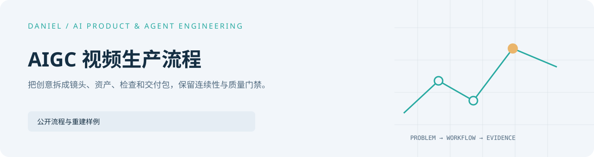

<picture>
  <source media="(prefers-color-scheme: dark)" srcset="../../assets/projects/aigc-video-production/cover-dark.svg" />
  
</picture>

# AIGC 视频生产流程

[English](README.en.md) · [完整作品目录](../../README.md)

将创意任务拆成镜头计划、视觉资产、检查记录和交付材料，管理一次修改对后续产物的影响。

## 当前公开内容

公开包提供流程说明、重建镜头审核样例和产物分类；完整创作源材料、Prompt 链和
完整生产操作流程保留私有。交付包用于解释、检查和交接工作，不等同于视频成片。

## 深入阅读

[流程（英文）](workflow.md) · [镜头审核样例（英文）](shot-review-sample.md) · [质量检查（英文）](quality-checks.md) · [产物地图（英文）](public-artifact-map.md) · [公开边界（英文）](public-scope.md)

这里没有独立运行程序；参考重点为镜头与资产依赖、审阅门禁和交付组织。
