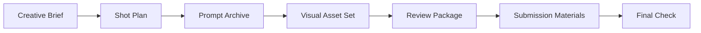

# AIGC Video Production Pipeline

I used this project to turn a short AI-generated video into a managed production job. Alongside the video, I kept shot plans, prompt records, asset reviews, delivery documents, and final checks.

In this context, "production package" means the material needed to explain, inspect, and hand off the work. It is separate from the video file itself.

## Work Included

- translating a creative brief into a production workflow
- tracking visual generation work across shots and assets
- turning prompts and review notes into structured artifacts
- packaging review materials into documents and spreadsheets
- using quality checks before final delivery

## Public Model



## My Role

I designed the production structure and kept the moving parts aligned around one question:

```text
How do we keep story, visual assets, prompts, documents, and final checks aligned while the project keeps changing?
```

- structuring the project into repeatable stages
- maintaining prompt and shot documentation
- generating review-ready documents and workbooks
- creating QA previews for visual inspection
- separating draft materials from release-ready materials

The full creative source material and complete operating process stay outside this folder.

## Production Problem

A change to one scene can affect the prompt record, selected asset, review notes, preview, and delivery document. I tracked those dependencies in one production package.

## Public Files

| File | Purpose |
| --- | --- |
| [Workflow](workflow.md) | High-level production workflow. |
| [Quality Checks](quality-checks.md) | Goals and checks used before delivery. |
| [Synthetic Shot Review](shot-review-sample.md) | A fake three-unit review and package decision. |
| [Artifact Map](public-artifact-map.md) | Artifact categories used in the public version. |
| [Scope](public-scope.md) | Public scope and boundary. |
| [Concept Cards](cards/) | Short concepts distilled from the project. |

## Status

Status: `approved_for_public_v1`
