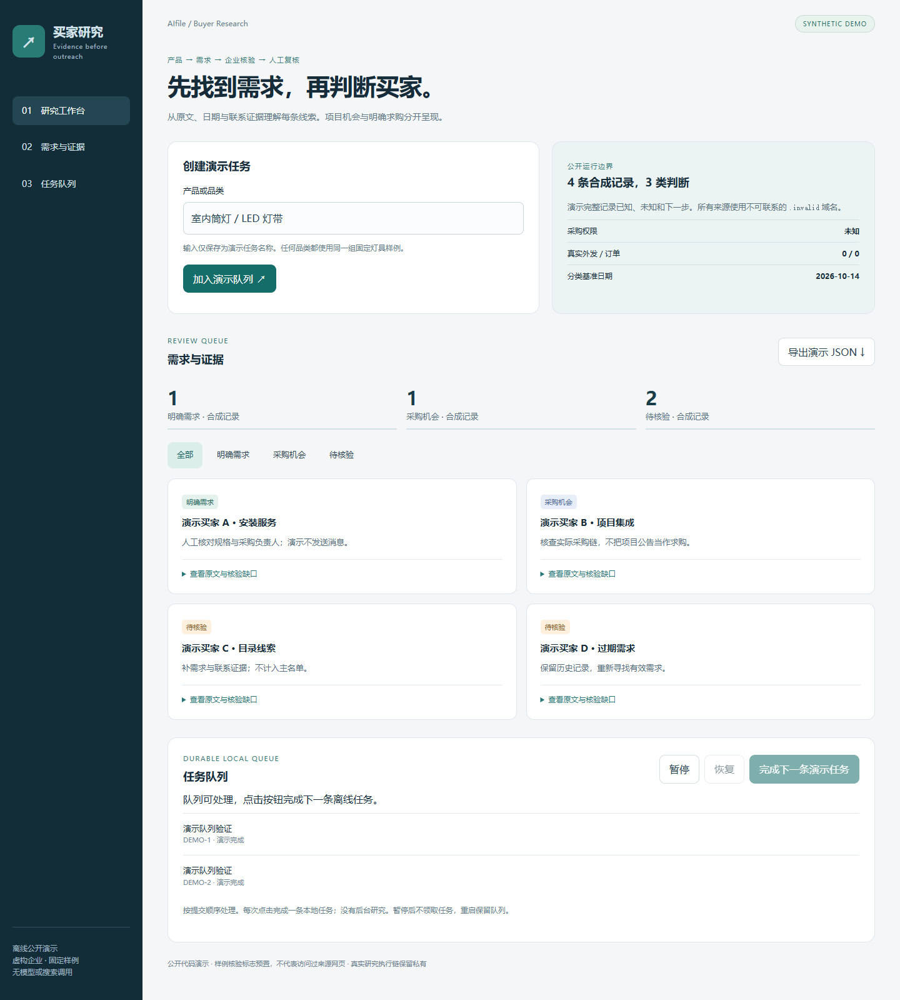

# Buyer Research Agent

A public reconstruction of a buyer-research workbench for business owners and
sales teams. The private workflow searches for demand, verifies companies and
contact evidence, and prepares reports for human review.

This package exposes an offline reference: a responsive workbench, evidence
classification, a durable demo queue and automated boundary tests.

## Start

[Run the offline workbench](../../shelves/code/buyer-research-demo/README.md).
It needs Python 3.11+ and uses only invented data. Read the
[Chinese case study](README.zh-CN.md), [architecture](architecture.md) and
[publication boundary](public-scope.md). The [reference guide](reference-guide.md)
documents normalized evidence and local API contracts.

## What can be inspected

- Explicit demand, project opportunity and pending evidence remain distinct.
- A directory match alone does not establish purchasing intent.
- Unknown procurement authority remains unknown after classification.
- Task labels persist in SQLite; pause, FIFO processing and cancellation are visible.
- Four fixtures expose quotes, dates, missing checks and next actions.

The offline results are fixed. There is no real buyer discovery, network research,
commercial contact list, model invocation, email delivery or order validation.
The private research system's reports and execution history are not included.
