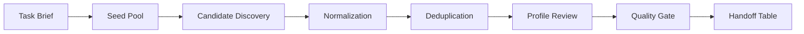

[中文](README.md)

# Creator Discovery Pipeline

I built this workflow to turn scattered public creator signals into a reviewable handoff table. It covers discovery, profile normalization, deduplication, eligibility checks, contact status, and human review.

## Work included

- converting a broad growth task into a data pipeline
- separating discovery, enrichment, scoring, review, and handoff
- using exclusion lists before collecting new candidates
- keeping uncertain fields visible while guesses stay out of the table
- excluding private names, accounts, contact data, platform details, and full operating recipes

## Pipeline

## My role

- defining the intake brief and output fields
- designing deduplication and exclusion rules
- separating raw candidates from reviewed candidates
- creating review gates for profile fit, activity, contactability, and risk
- packaging results into workbook-style handoff artifacts
- keeping sensitive inputs and original outputs out of the public version

## Handoff problem

Creator discovery can look simple from the outside: search, copy names, make a sheet.

A usable lead table needs fixed definitions, exclusion rules, traceable decisions, and a human check before handoff.

## Files

| File | Purpose |
| --- | --- |
| [Architecture](architecture.md) | Pipeline layers and responsibilities. |
| [Evidence and Review](evidence-and-review.md) | Review gates, evidence classes, and acceptance states. |
| [Synthetic Review Record](review-sample.fake.json) | Approved, review-needed, and blocked fake records. |
| [Sample Table](public-sample.md) | Fake rows and public field examples. |
| [Code Skeleton](../../shelves/code/creator-discovery-skeleton/) | Small governance skeleton with fake data only. |
| [Redaction Policy](redaction-policy.md) | What stays out of the public folder. |
