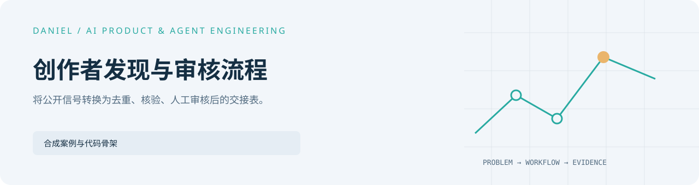

<picture>
  <source media="(prefers-color-scheme: dark)" srcset="../../assets/projects/creator-discovery-pipeline/cover-dark.svg" />
  
</picture>

# 创作者发现与审核流程

[English](README.en.md) · [完整作品目录](../../README.md)

将零散公开信号整理为可审核的交接表，重点是候选规范化、去重、排除条件和人工复核。

## 当前实现

公开包包含系统说明、合成审核记录和一个可运行的规则骨架。真实名单、联系信息、
平台账号和完整操作流程保留私有；这里不声称产出了真实合作或业务转化。

## 阅读与运行

[代码与测试](../../shelves/code/creator-discovery-skeleton/) · [合成审核记录](review-sample.fake.json) · [样例表](public-sample.md)

[架构（英文）](architecture.md)说明发现、规范化、去重与审核职责；
[证据与复核（英文）](evidence-and-review.md)区分通过、待复核和阻断。
[公开边界（英文）](redaction-policy.md)列出不公开材料。
