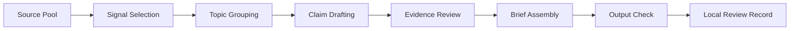

# Daily Brief Agent

I built this workflow for recurring information review. It groups sources, labels evidence, organizes topics, checks citations, and produces a brief for manual review.

## Work Included

- organizing recurring information intake
- separating source discovery from brief writing
- grouping signals by theme and evidence quality
- marking single-source or uncertain claims before publication
- checking that cited sources are present before accepting an output
- excluding the private source list, daily outputs, and generation scripts

News coverage, investment memos, source lists, and collection recipes stay outside this folder.

## System Model

## My Role

- defining brief sections and source categories
- tracking source IDs inside the generated output
- separating official sources, media sources, social signals, and market references
- marking weak evidence clearly
- generating reviewable brief artifacts
- checking missing references before accepting the final brief

## Working Problem

Daily information work can become a stream of tabs and copied notes.

I wanted a brief where every claim still points back to a source class and source ID, and weak evidence remains visible during review.

## Public Files

| File | Purpose |
| --- | --- |
| [Architecture](architecture.md) | Information workflow layers and responsibilities. |
| [Evidence and Review](evidence-and-review.md) | Evidence labels, review gates, and output checks. |
| [Synthetic Review Record](brief-review-sample.fake.json) | Ready, review-needed, and blocked fake brief items. |
| [Sample Brief](public-sample.md) | Fake brief item and source examples. |
| [Code Skeleton](../../shelves/code/daily-brief-skeleton/) | Small review skeleton with fake data only. |
| [Redaction Policy](redaction-policy.md) | What stays out of the public folder. |

## Status

Status: `approved_for_public_v1`

This package contains reconstructed examples and synthetic records.
