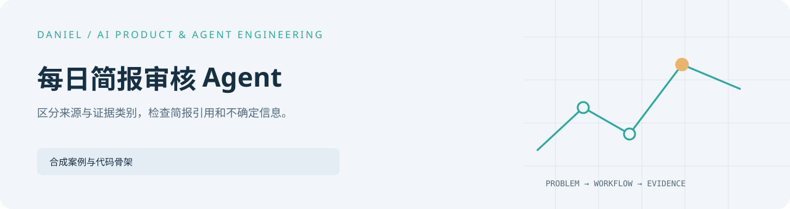

<picture>
  <source media="(prefers-color-scheme: dark)" srcset="../../assets/projects/daily-brief-agent/cover-dark.svg" />
  
</picture>

# 每日简报审核 Agent

[English](README.en.md) · [完整作品目录](../../README.md)

为重复的信息整理工作建立来源分类、证据标记和引用检查，保留弱证据与缺失引用。

## 当前实现

公开版为重建说明、合成记录和引用审核骨架，不包含实时新闻采集、私有来源清单、
日报原文和生成脚本。代码验证来源与声明关系，不代表简报自动发布。

## 阅读与运行

[代码与测试](../../shelves/code/daily-brief-skeleton/) · [合成审核记录](brief-review-sample.fake.json)

[架构（英文）](architecture.md) · [证据与审核（英文）](evidence-and-review.md) · [样例简报（英文）](public-sample.md) · [公开边界（英文）](redaction-policy.md)
