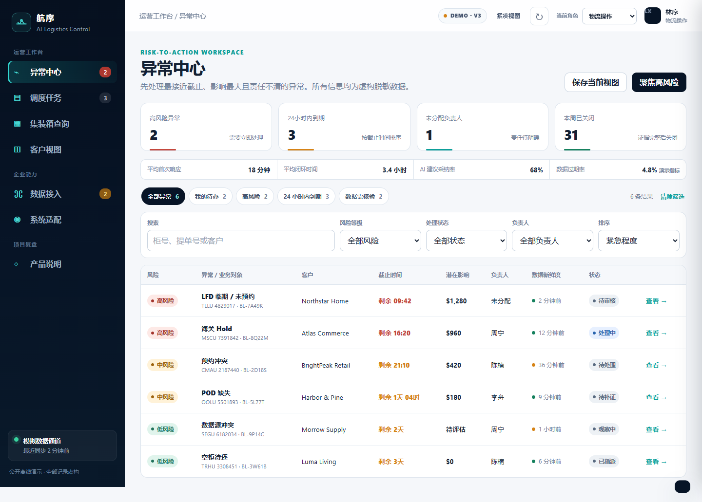

# Hangxu Logistics Workbench

A public product reconstruction of an AI-assisted cross-border logistics
operations desk: exception review, task coordination and filtered customer status.



## Start

[Run the local workbench](../../shelves/code/logistics-workbench-demo/README.md).
It uses a static server and invented business records. See the
[Chinese case study](README.zh-CN.md), [architecture](architecture.md) and
[publication boundary](public-scope.md). The [reference guide](reference-guide.md)
documents role actions, task states and production adaptation requirements.

## Inspect the operating loop

```text
synthetic logistics event -> exception -> facts and missing information
  -> fixed AI suggestion -> human review -> dispatch task
  -> simulated evidence submission -> closure -> customer status
```

Five roles expose different product views and action permissions. Stale or weak
evidence blocks direct approval. Integration pages illustrate normalized events,
source conflicts, terminal layouts and system adaptation using mock state.

This is a product demo, not a deployed logistics system. Static role switching
provides no secure authentication. Suggested actions, confidence, fees and health
figures are fixtures; completion does not verify a real dispatch or document.
