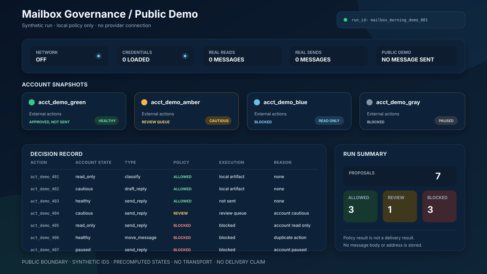

[中文](README.md)

# Mailbox Governance Agent

I built the private workflow to review incoming messages, prepare drafts, route
proposed actions, and preserve local decision records. This public package uses
fake inputs to show which actions pass the checks and which ones are stopped.

It has no mailbox connection, credentials, provider settings, message bodies,
contact records, or delivery code.

## One synthetic morning run



The demo starts with four precomputed account states and seven proposed actions.
It does not calculate account health or connect to a provider.

Run it from `shelves/code/mailbox-governance-skeleton/`:

```powershell
python public_demo.py
```

The captured run has this result:

```text
proposals=7
allowed=3
needs_review=1
blocked=3
network_enabled=false
credentials_loaded=false
real_messages_read=0
real_messages_sent=0
```

An allowed local action produces a local artifact. If an external action passes
the checks, the demo marks it as `mock_queue_only`: approved, but not sent. The
public code never sends or changes a message.

## Decision path

```text
synthetic trigger
  -> precomputed account snapshot
  -> normalized action metadata
  -> approval and raw-content checks
  -> duplicate check
  -> account-state gate
  -> keep it local, ask for review, approve without sending, or block
  -> JSON decision record
```

## Account states

| State | Local analysis | Approved external action |
| --- | --- | --- |
| `healthy` | Local artifact only | Checks pass, but nothing is sent |
| `cautious` | Local artifact only | Needs review |
| `read_only` | Local artifact only | Blocked |
| `paused` | Local artifact only | Blocked |

These states are supplied as synthetic input. The private thresholds and health
calculation do not appear in this repository.

## Public package

| File | Contents |
| --- | --- |
| [Architecture](architecture.md) | Public layers, account-state gate, and control points. |
| [Evidence and review](evidence-and-review.md) | Decision meanings, review gates, and valid claims. |
| [Synthetic morning run](morning-run.fake.json) | Full JSON output from the public demo. |
| [Synthetic decision record](decision-sample.fake.json) | Three smaller action-review examples. |
| [Sample tables](public-sample.md) | Human-readable synthetic records. |
| [Code skeleton](../../shelves/code/mailbox-governance-skeleton/) | Local policy demo and tests. |
| [Redaction policy](redaction-policy.md) | Materials excluded or generalized for publication. |

## Public boundary

This package contains synthetic account aliases, message references, actions,
and decisions. It excludes message text, real addresses, provider access,
business lists, operational thresholds, production prompts, transport code,
delivery claims, and the complete private workflow.
