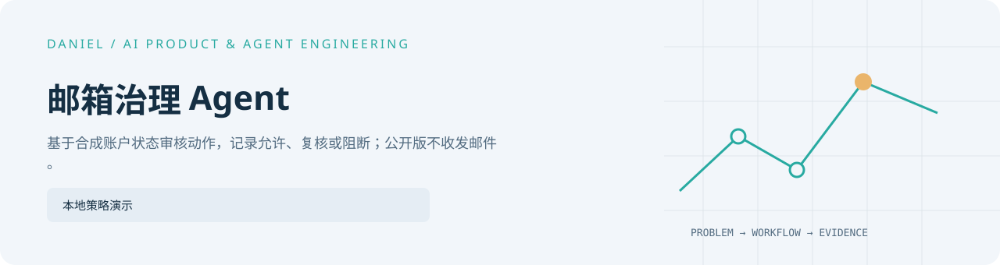

<picture>
  <source media="(prefers-color-scheme: dark)" srcset="../../assets/projects/mailbox-governance-agent/cover-dark.svg" />
  
</picture>

# 邮箱治理 Agent

[English](README.en.md) · [完整作品目录](../../README.md)

把拟议动作、审批、重复检查和账户状态分开记录。公开版本用合成输入演示哪些
动作可以保留在本地，哪些需要复核，以及哪些会被阻断。

## 当前实现与运行

从[公开代码目录](../../shelves/code/mailbox-governance-skeleton/)运行 python public_demo.py。
合成晨间运行包含 7 个提议：3 个允许、1 个待复核、3 个阻断。允许的对外动作只标为
模拟待执行，不发送。网络连接和凭据均未启用，真实读取与发送均为 0。

四种账户状态为预设输入；公开代码没有账户健康计算、服务商连接或邮件传输。

## 深入阅读

[合成晨间记录](morning-run.fake.json) · [架构（英文）](architecture.md) · [证据与复核（英文）](evidence-and-review.md) · [公开边界（英文）](redaction-policy.md)
