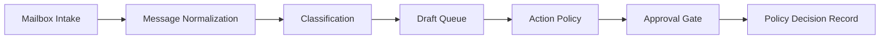

# Mailbox Governance Agent

I built the private workflow to handle incoming messages, prepare drafts, review proposed actions, block repeated action IDs, and keep local decision records.

The original work connected mailbox operations with an agent policy layer. Reading and classification were separated from actions that change mailbox state or contact another person.

## System shape

## Operating rules

I organized the workflow around a few operating rules:

- mailbox intake stays separate from outbound action
- uncertain classifications remain visible
- drafts and sends use different states
- external actions pass through an approval gate
- duplicate actions are blocked before execution
- audit records avoid message bodies and contact details

The package stops at the action-review gate. Account health, scheduling, transport behavior, message content, and provider access stay private.

## Public package

| File | Contents |
| --- | --- |
| [Architecture](architecture.md) | Public system layers and control points. |
| [Evidence and Review](evidence-and-review.md) | Review gates and action states. |
| [Synthetic Decision Record](decision-sample.fake.json) | Allowed, review-needed, and duplicate-blocked fake actions. |
| [Sample Tables](public-sample.md) | Synthetic message and action records. |
| [Code Skeleton](../../shelves/code/mailbox-governance-skeleton/) | A small action-review skeleton with fake data. |
| [Redaction Policy](redaction-policy.md) | Materials excluded from the public version. |
