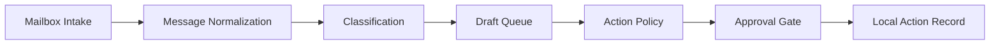

# Mailbox Governance Agent

This public case is based on a private mailbox workflow that handles incoming messages, draft preparation, action review, duplicate protection, and local audit records.

The original work connected mailbox operations with an agent policy layer. Reading and classification were separated from actions that change mailbox state or contact another person.

## System shape

## My work

I organized the workflow around a few operating rules:

- mailbox intake stays separate from outbound action
- uncertain classifications remain visible
- drafts and sends use different states
- external actions pass through an approval gate
- duplicate actions are blocked before execution
- audit records avoid message bodies and contact details

The private system also explored account health, scheduling, and transport behavior. Those details are outside this public package.

## Public package

| File | Contents |
| --- | --- |
| `architecture.md` | Public system layers and control points. |
| `evidence-and-review.md` | Review gates and action states. |
| `redaction-policy.md` | Materials excluded from the public version. |
| `public-sample.md` | Synthetic message and action records. |
| `../../shelves/code/mailbox-governance-skeleton/` | A small action-review skeleton with fake data. |

## Status

Status: `approved_for_public_v1`

This is a public adaptation, not the original private workspace.
