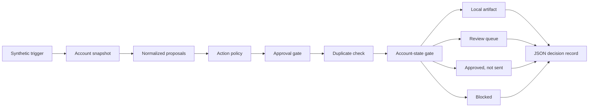

# Architecture

The public demo begins after mailbox intake and account-health calculation. It
receives synthetic references, precomputed account states, and normalized action
metadata.

## Public flow

## Layers

| Layer | Public responsibility |
| --- | --- |
| Synthetic trigger | Starts a deterministic local run. It is not a scheduler. |
| Account snapshot | Supplies a fake alias and one of four allowed states. |
| Normalized proposal | Carries IDs, action type, approval state, and a raw-content flag. |
| Action policy | Rejects missing, unknown, inconsistent, or raw-content inputs. |
| Approval gate | Holds external actions without an approval reference. |
| Duplicate check | Blocks an action ID that already exists in the synthetic record. |
| Account-state gate | Restricts external actions according to the supplied account state. |
| Decision record | Stores policy and execution states without message content. |

## Output states

| Execution state | Meaning |
| --- | --- |
| `local_artifact_only` | The action stays inside the local analysis boundary. |
| `review_queue` | A person must resolve the policy reason before another system can act. |
| `mock_queue_only` | The checks passed, but the demo does not send or change any message. |
| `blocked` | The proposal cannot continue. |

## Invariants

- The demo sets `network_enabled` and `credentials_loaded` to false.
- Real message read and send counts stay at zero.
- A generated draft remains a local artifact.
- External actions need an approved state and approval reference.
- `cautious`, `read_only`, and `paused` restrict external actions.
- A repeated action ID is blocked before release.
- Decision records contain references and reason codes, not raw content.

## Private boundary

The private system owns account-health calculations, provider connections,
scheduling, message parsing, templates, contact sources, retry behavior,
operational thresholds, and delivery handling. None of those components are
called by the public demo.
