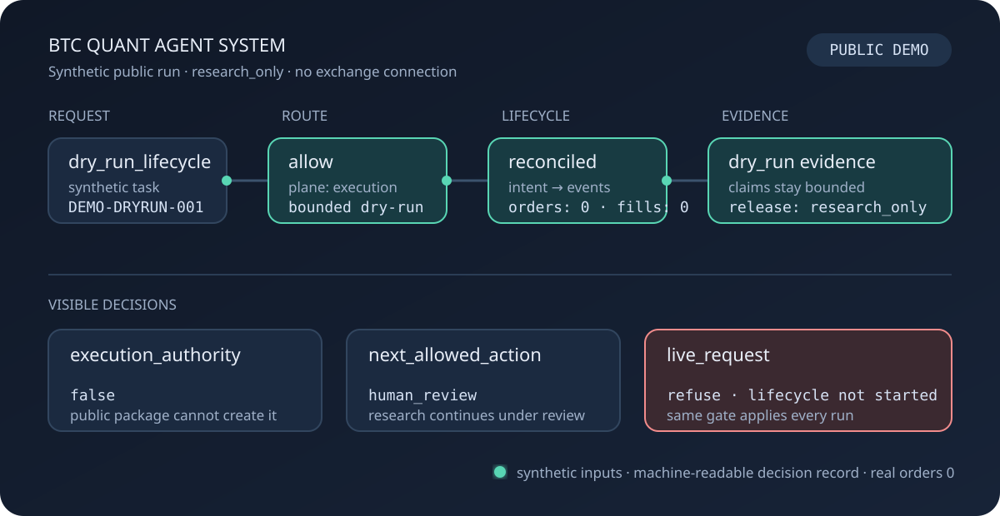

# BTC Quant Agent System

[](https://github.com/Daniel-24-life/AIfile/actions/workflows/public-package-tests.yml)

I built the private system for governed BTC quantitative research. This public
package runs a small, inspectable part of it: task routing, a dry-run lifecycle,
evidence classification, and promotion checks.

It contains no strategy logic, market data, results, credentials, or exchange
connection.

## Current boundary

| Item | Public state |
| --- | --- |
| Private system status | `research_only` |
| Public demonstration | Runnable with synthetic scenarios |
| Planes represented | Research, execution, governance, orchestration |
| Evidence output | Machine-readable JSON decision record |
| Execution authority | None |
| Real orders or fills | None |
| Repository release | `v2.2` |

## One governed run




The animated view shows one synthetic dry-run from request to bounded release.
It does not connect to an exchange or represent real orders, fills, market data,
or strategy results.

Every run records two decisions:

1. whether a task may enter a bounded operating plane
2. what claims the resulting artifact is allowed to support

An allowed research task remains research work. A reconciled dry-run remains
dry-run evidence. A live request is refused before lifecycle work begins.

## Run it

From `shelves/code/agent-governance-skeleton/`:

```powershell
python public_demo.py
```

The command executes four scenarios through the public code:

```text
BTC QUANT AGENT SYSTEM - PUBLIC GOVERNANCE DEMO

SCENARIO                 ROUTE              RELEASE          AUTHORITY
research_candidate       allow              research_only    none
dry_run_lifecycle        allow              research_only    none
promotion_request        approval_required  blocked          none
live_request             refuse             blocked          none

real_orders_submitted=0
real_fills_recorded=0
system_status=research_only
```

See the [walkthrough](demo-walkthrough.md) for the decision rules or open the
[captured JSON run](demo-run.fake.json).

## Four operating surfaces

| Surface | Responsibility | Public behavior |
| --- | --- | --- |
| Research plane | Questions, candidates, validation, research artifacts | May produce research evidence; cannot grant execution authority. |
| Execution plane | Intent, event, reconciliation, and incident schemas | Runs dry-run lifecycle only; real-order and real-fill flags stay false. |
| Governance plane | Evidence classes, claim control, protected decisions | Blocks missing, unsupported, or stronger-than-evidence claims. |
| Orchestrator | Select one authorized task and preserve plane policy | Cannot override governance or create authority by routing alone. |

The public run follows this path:

```text
orchestrator/task_router.py
  -> execution/dryrun_lifecycle.py
  -> governance/evidence_classifier.py
  -> governance/promotion_gate.py
  -> public_demo.py
  -> demo-run.fake.json
```

## Why promotion stays blocked

Failed and incomplete evidence stays in the record. Completing a workflow does
not authorize deployment, and a complete research package still cannot cross
the current status ceiling.

The live-request scenario stops before lifecycle work:

```text
request: enable live trading after the public demo
route: refuse
lifecycle: not started
release: blocked
execution_authority: false
```

## Evidence files

| File | Contents |
| --- | --- |
| [Public Demo Walkthrough](demo-walkthrough.md) | Commands, scenarios, and decision interpretation. |
| [Synthetic Demo Run](demo-run.fake.json) | Full JSON output from the public runner. |
| [Architecture](architecture.md) | Plane model and subsystem boundaries. |
| [Governance Model](governance-model.md) | Fail-closed rules and forbidden silent upgrades. |
| [Evidence Lifecycle](evidence-lifecycle.md) | Artifact, audit, classification, and claim flow. |
| [Synthetic Overclaim Record](evidence-sample.fake.json) | Example of a dry-run artifact attempting an unsupported real-fill claim. |
| [Public Code Map](public-code-map.md) | Links from the case study to the sanitized implementation. |
| [Redaction Policy](redaction-policy.md) | Materials excluded or generalized for publication. |

## Public boundary

This repository contains reconstructed examples and synthetic records.

It excludes:

- strategy formulas and candidate pools
- market datasets and private source paths
- backtest, validation, return, and order results
- credentials, accounts, or exchange access
- private prompts, task queues, and system dialogue
- paper or live enablement
