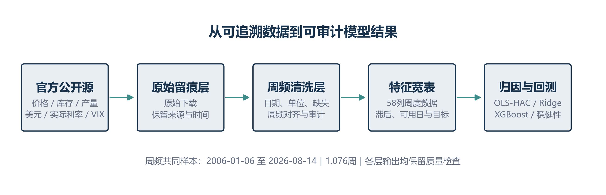

# WTI Market Research Case

This anonymous commercial research case examines two questions: which public
weekly factors move with WTI returns, and whether the same factors can predict
the following week.

The analysis uses seven official FRED and EIA series, 1,076 weekly observations
from 2006-01-06 through 2026-08-14, and a 240-week held-out test period. The
result is deliberately modest. Dollar and VIX changes have clearer same-week
relationships with WTI, while Ridge and XGBoost do not beat the historical-mean
forecast on the formal test set.

## Research decision

The public weekly factors are useful for risk monitoring and same-week
attribution. They are not stable next-week trading signals in this study.

That distinction shaped the work. Same-week explanation and next-week
prediction use separate specifications, and every predictive feature is checked
against its assumed availability date.

## Work included

- traced seven public series from source files into a weekly feature table
- kept observation dates separate from assumed availability dates
- excluded a mechanically contaminated spread-change term from the explanatory regression
- used OLS with HAC standard errors for same-week attribution
- froze model choices before opening the 2022-2026 test period
- compared Ridge and XGBoost with zero-return and historical-mean baselines
- recorded limits that change how the results may be used

## Main findings

| Question | Result | Public interpretation |
| --- | --- | --- |
| Same-week relationship | OLS-HAC R-squared was 0.0763. Dollar and VIX changes were negative at the 5% level. | Useful as a limited attribution view, not a causal model. |
| Next-week return | Test RMSE was 0.05942 for the historical mean, 0.06192 for Ridge, and 0.06126 for XGBoost. | The formal models did not beat the simple benchmark. |
| Next-week direction | Balanced accuracy was 0.4894 for Logistic Ridge and 0.5093 for XGBoost. | Directional performance remained close to chance. |
| Stress periods | Weekly volatility reached 117.5% annualized in 2020. | Extreme weeks need separate monitoring and should not be averaged away. |

## Files

| File | Purpose |
| --- | --- |
| [Public report (PDF)](report/wti-weekly-market-research-public-case.pdf) | Five-page anonymous case report with reviewed layout and metadata. |
| [Editable public report (Word)](report/wti-weekly-market-research-public-case.docx) | Sanitized Word version derived from the private report template. |
| [Chinese research note](research-note.zh-CN.md) | Concise public version of the analysis and findings. |
| [Architecture](architecture.md) | Data, feature, model, and review layers. |
| [Evidence and review](evidence-and-review.md) | Frozen numbers, acceptance checks, and claim limits. |
| [Public sample](public-sample.md) | Synthetic availability and review records. |
| [Source register](sources.md) | Official series, links, frequencies, and citation notes. |
| [Code skeleton](../../shelves/code/wti-research-audit-skeleton/) | Runnable synthetic checks for timing, leakage, and frozen tests. |
| [Redaction policy](redaction-policy.md) | Materials kept outside the public repository. |

## Scope

This package contains a reconstructed narrative, selected charts, a sanitized
report, and a small synthetic audit program. It does not contain the
commissioning organization, application context, raw downloads, the research
database, complete scripts, internal handoffs, or the original report files.

The results describe one historical sample. They are not investment advice and
do not represent a production trading strategy.
