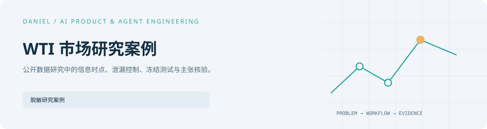

<picture>
  <source media="(prefers-color-scheme: dark)" srcset="../../assets/projects/wti-market-research/cover-dark.svg" />
  
</picture>

# WTI 市场研究案例

[English](README.en.md) · [完整作品目录](../../README.md)

基于七条官方公开序列，区分同周解释与下周预测，检查信息可用时点、泄漏和冻结测试。

## 当前研究结论

公开报告覆盖 2006-01-06 至 2026-08-14 的 1,076 个周度观察与 240 周正式测试集。
美元和 VIX 变化具有较清晰的同周关系；Ridge 与 XGBoost 未优于历史均值预测基准。
这些结果描述历史样本，不构成稳定的下周交易信号。

## 阅读与复核

[中文研究说明](research-note.zh-CN.md) · [公开 PDF](report/wti-weekly-market-research-public-case.pdf) · [公开 Word](report/wti-weekly-market-research-public-case.docx)

[审计代码与测试](../../shelves/code/wti-research-audit-skeleton/)运行合成时点、泄漏与冻结检查。
[来源清单（英文）](sources.md) · [架构（英文）](architecture.md) · [证据与限制（英文）](evidence-and-review.md)

委托关系、原始下载、数据库、完整脚本链和原报告均未公开；数值与研究限制沿用已发布材料。
