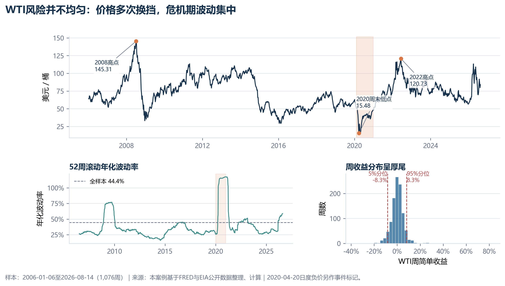
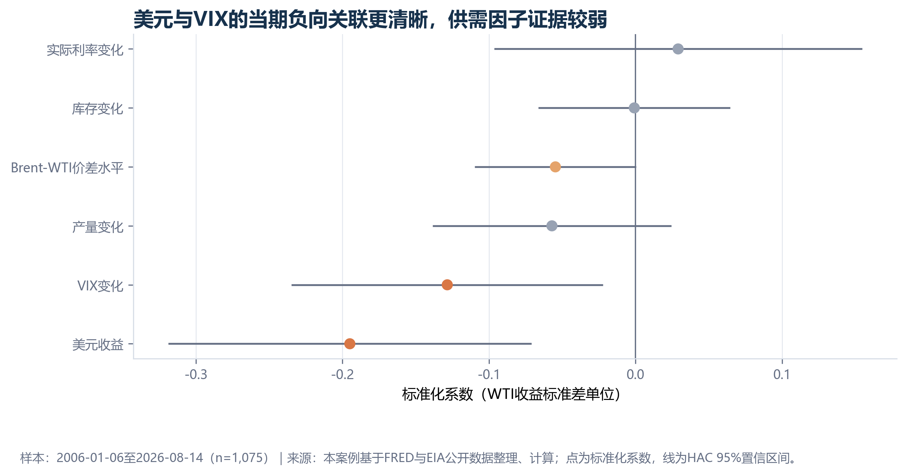
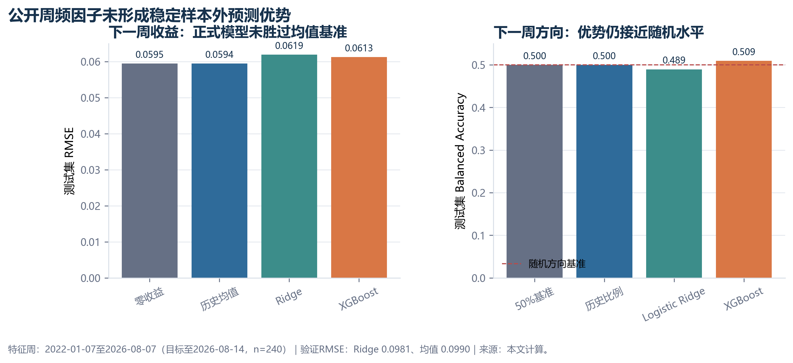

# Evidence and Review

The public evidence is tied to frozen outputs from one completed research run.
The tables below state what was checked and how far each result can be used.

## Frozen scope

| Item | Value |
| --- | --- |
| Common weekly sample | 2006-01-06 to 2026-08-14, 1,076 weeks |
| OLS sample | 1,075 weeks |
| Training period | Through 2018-12-28 |
| Validation period | 2019-2021 |
| Formal test period | 2022-2026, 240 target weeks |
| Explanatory model | Multivariate OLS with HAC(4) standard errors |
| Predictive models | Ridge, Logistic Ridge, and XGBoost |

## Result checks

| Check | Evidence | Review outcome |
| --- | --- | --- |
| Same-week fit | OLS-HAC R-squared = 0.0763 | Limited explanatory power; no causal claim. |
| Dollar relationship | Coefficient = -1.5742, p = 0.0021 | Negative in the full sample; not stable enough to treat as a fixed law. |
| VIX relationship | p = 0.0179 | Negative in the main and alternative-start samples; still observational. |
| Return forecast | Historical mean RMSE = 0.05942; Ridge = 0.06192; XGBoost = 0.06126 | Formal models did not beat the historical-mean baseline. |
| Direction forecast | Logistic Ridge = 0.4894; XGBoost = 0.5093 balanced accuracy | Close to chance. |
| Negative-price event | Daily WTI was -36.98 on 2020-04-20; the weekly model value was 15.99 on 2020-04-24 | Daily event and weekly aggregation remain separate. |

## Acceptance gates

| Gate | Pass condition |
| --- | --- |
| Source gate | Every series has an official page, unit, frequency, and download record. |
| Key gate | The weekly feature table has one row per week and no duplicate key. |
| Timing gate | Predictive features satisfy the stated availability rule. |
| Leakage gate | Features containing the target by identity are removed from explanatory models. |
| Split gate | Test rows are not used for feature selection or parameter tuning. |
| Baseline gate | Formal models and simple baselines use the same held-out rows and metric. |
| Claim gate | Charts and prose do not turn association into causation or weak forecasts into strategy claims. |

## Visual evidence

The coefficient chart shows HAC 95% confidence intervals. Standardization is
used for comparison across features, not to imply economic causality.

The left panel reports formal test RMSE. Its footer also records the separate
validation-period comparison used while selecting the Ridge setting. The right
panel reports formal test balanced accuracy against a 0.5 reference line.

## Claim limits

- Statistical association is not a causal effect.
- The weekly value around the April 2020 event is not the daily negative price.
- In-sample residuals from a stress period are not out-of-sample forecast errors.
- SHAP diagnostics from a model with negative test R-squared do not establish factor importance.
- A small result under one sensitivity setting does not establish stable forecast skill.
